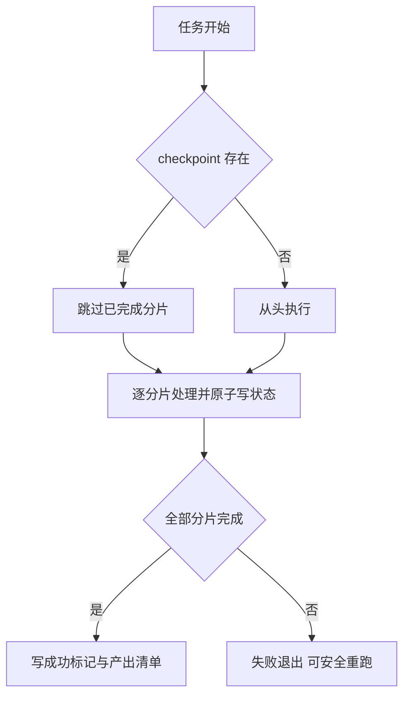

### Q1071 · 管道断点续跑与重跑设计

> 难度:★★★★ | 标签:数据工程, 幂等

**问**:跑了 3 小时的任务在第 4 个分片挂了,重跑要再等 3 小时吗?怎么设计断点续跑?

**答**:把任务拆成可独立重跑的分片,用一个 checkpoint 文件记录已完成分片;重跑时先读 checkpoint 跳过完成项。两个工程细节决定可靠性:checkpoint 写入必须原子(临时文件 + `os.replace`),否则崩溃时留下半写状态比没有更糟;每个分片的处理本身要幂等(先删后写或 upsert),这样"断点续跑"和"全量重跑"才是同一条代码路径。失败语义也要明确:单分片失败是中断还是跳过,要在配置里声明。

```python
# file: code/05_数据分析与工程化/q1071_checkpoint_resume.py
import json
import os
import tempfile

CHECKPOINT = os.path.join(tempfile.gettempdir(), "q1071_ckpt.json")

def load_done():
    if os.path.exists(CHECKPOINT):
        with open(CHECKPOINT, encoding="utf-8") as f:
            return set(json.load(f))
    return set()

def save_done(done):
    tmp = CHECKPOINT + ".tmp"
    with open(tmp, "w", encoding="utf-8") as f:
        json.dump(sorted(done), f)
    os.replace(tmp, CHECKPOINT)  # 原子替换,崩溃不会留下半写状态

def run(shards):
    done = load_done()
    for s in shards:
        if s in done:
            print("跳过已完成分片", s)
            continue
        print("处理分片", s)
        done.add(s)
        save_done(done)

if __name__ == "__main__":
    run([f"shard-{i}" for i in range(4)])
    print("第二次执行(模拟重跑):")
    run([f"shard-{i}" for i in range(4)])
    os.remove(CHECKPOINT)
```

**追问**:
- 追问 1:checkpoint 和调度系统的重试什么关系?—— 调度重试是任务级,checkpoint 是任务内分片级,两层正交可叠加。
- 追问 2:分片产出如何保证不被半写?—— 每个分片写临时文件后 rename,消费方只读最终命名文件,配合清单文件声明有效分片。


