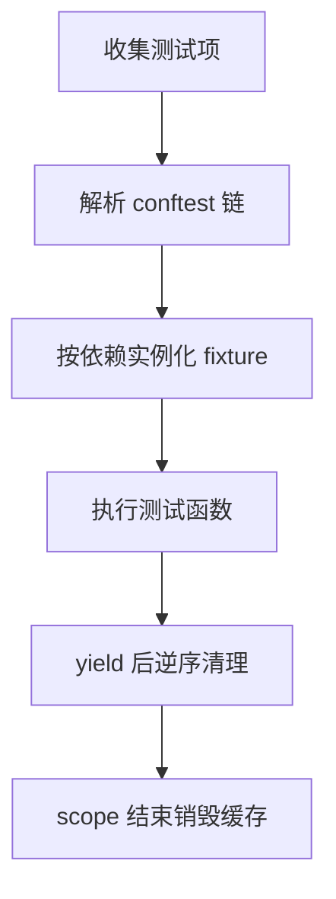

### Q1082 · request.getfixturevalue 动态夹具

> 难度:★★★★ | 标签:pytest, fixture

**问**:测试运行中才知道要用哪个 fixture(比如按配置选数据库),怎么办?

**答**:用 `request.getfixturevalue("名字")` 在测试体内按需解析 fixture,替代静态参数注入。典型场景:配置驱动选择 fixture、循环里依次取多个 fixture、条件性跳过某些 setup。注意三点:getfixturevalue 不走声明式依赖图,fixture 缓存(scope)仍然生效,同 scope 内重复取返回同一实例;名字拼错运行时才报错,建议封装一层常量;过度使用会让依赖关系不可见,评审时要克制,常规依赖仍走参数注入。

```python
# file: code/05_数据分析与工程化/q1082_getfixturevalue.py

FIXTURES = {}

def fixture(fn):
    FIXTURES[fn.__name__] = fn
    return fn

@fixture
def config(request):
    return {"env": "test"}

@fixture
def db(request):
    cfg = request.getfixturevalue("config")
    return f"connected to {cfg['env']}"

class FakeRequest:
    def __init__(self):
        self._cache = {}

    def getfixturevalue(self, name):
        if name not in self._cache:
            self._cache[name] = FIXTURES[name](self)
        return self._cache[name]

if __name__ == "__main__":
    # pytest 里:db = request.getfixturevalue("db") 按需解析
    req = FakeRequest()
    print(req.getfixturevalue("db"))
    print("scope 缓存生效:", req.getfixturevalue("db") is req.getfixturevalue("db"))
```

**追问**:
- 追问 1:getfixturevalue 和函数参数注入的区别?—— 前者是运行时按名字解析,后者是收集期静态解析,前者灵活但依赖不可见。
- 追问 2:同名 fixture 在不同 scope 会取到哪个?—— 就近原则,内层 conftest 覆盖外层,getfixturevalue 遵循同一覆盖规则。


