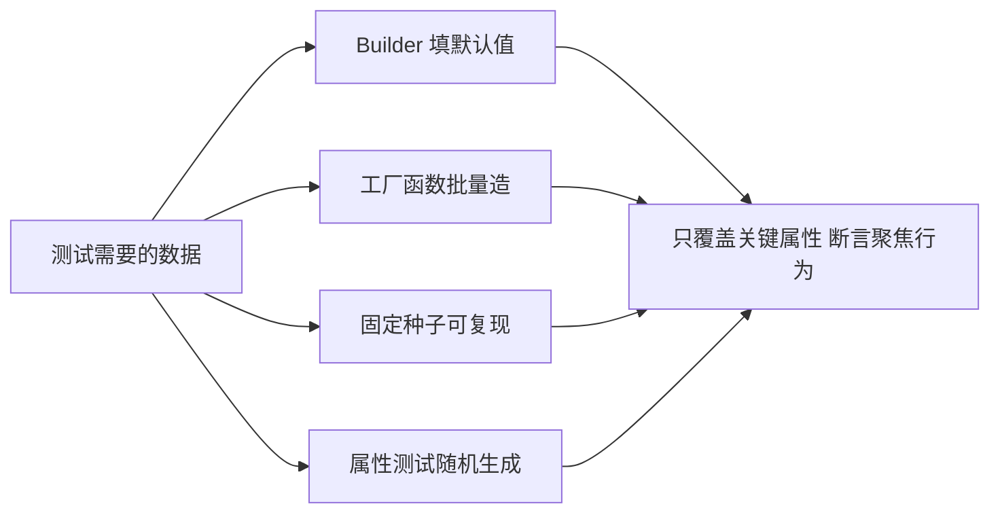

### Q1087 · 手写简化版属性测试与反例缩小

> 难度:★★★★ | 标签:property-based, 测试

**问**:不装 hypothesis,面试手写一个 mini 属性测试框架,你会写哪几块?

**答**:三块:生成器(按类型随机生成输入)、性质检查(循环 N 次执行属性断言)、反例缩小(失败时贪心删减输入直到不能再小)。缩小是灵魂,面试加分点:对列表做"逐个删除",失败则接受更小的反例继续,得到最小失败输入;对整数做向 0 逼近。写完能现场演示"sorted(set(x)) 丢重复元素"这类 bug 的最小反例(如 [0, 0]),比讲概念有说服力得多。

```python
# file: code/05_数据分析与工程化/q1087_mini_property_test.py
import random

def prop_len_preserved(input_list):
    out = sorted(set(input_list))  # 故意有 bug 的实现:去重导致长度不守恒
    return len(out) == len(input_list)

def shrink_list(xs, prop):
    """贪心缩小:逐个删元素,仍失败则保留更小反例"""
    current = list(xs)
    i = 0
    while i < len(current):
        candidate = current[:i] + current[i + 1:]
        if not prop(candidate):
            current = candidate
        else:
            i += 1
    return current

def run_property(prop, cases=50, seed=1):
    random.seed(seed)
    for _ in range(cases):
        xs = [random.randint(0, 3) for _ in range(random.randint(1, 8))]
        if not prop(xs):
            return shrink_list(xs, prop)
    return None

if __name__ == "__main__":
    minimal = run_property(prop_len_preserved)
    if minimal is None:
        print("本轮随机未触发 bug")
    else:
        print(f"发现最小反例: {minimal},重复元素被 sorted(set()) 丢弃")
```

**追问**:
- 追问 1:缩小的通用策略有哪些?—— 删元素、二分截断、数值向 0、字符串向空,组合使用直到不动点。
- 追问 2:怎么避免缩小后的反例误导?—— 缩小只改变输入复杂度不改变失败原因,报告里同时打印原始输入与最小反例。


