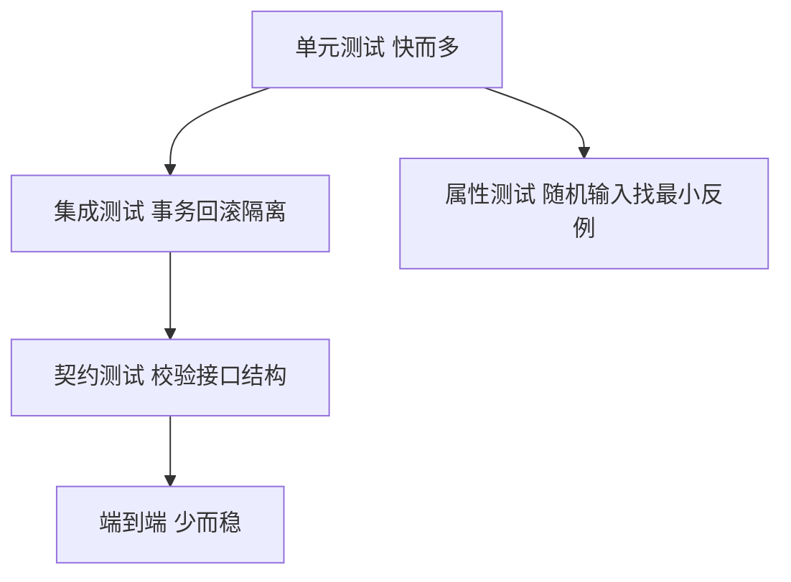

### Q1092 · 集成测试的数据库 fixture 事务回滚

> 难度:★★★★ | 标签:pytest, 数据库, 集成测试

**问**:集成测试连真实数据库,怎么让每个测试的数据互相隔离、跑完零残留?

**答**:主流三案:事务回滚(每个测试包在 BEGIN...ROLLBACK 里,速度快、隔离强,但测不到"跨事务提交"行为)、truncate 清表(每测后清,真实但慢,适合验证提交语义)、独立 schema/临时库(隔离最彻底,成本最高)。工程默认用事务回滚:fixture 里 `BEGIN` + yield + `ROLLBACK`,被测代码必须复用测试传入的连接才有效;要测 commit 行为的用例单独标 marker 走 truncate。SQLite 内存库是单测级集成测试的常用替身。

```python
# file: code/05_数据分析与工程化/q1092_db_fixture_rollback.py
import sqlite3

def make_conn():
    conn = sqlite3.connect(":memory:", isolation_level=None)  # 手动控制事务
    conn.execute("CREATE TABLE users (id INTEGER PRIMARY KEY, name TEXT)")
    conn.execute("BEGIN")
    return conn

class DBFixture:
    """每个测试一个事务,结束回滚,数据零残留"""

    def __init__(self):
        self.conn = make_conn()

    def add(self, name):
        self.conn.execute("INSERT INTO users (name) VALUES (?)", (name,))
        return self.conn.execute("SELECT last_insert_rowid()").fetchone()[0]

    def count(self):
        return self.conn.execute("SELECT COUNT(*) FROM users").fetchone()[0]

    def rollback(self):
        self.conn.execute("ROLLBACK")

if __name__ == "__main__":
    db = DBFixture()
    db.add("alice")
    db.add("bob")
    assert db.count() == 2
    db.rollback()
    assert db.count() == 0, "回滚后应零残留,测试间天然隔离"
    print("事务回滚隔离验证通过")
```

**追问**:
- 追问 1:被测代码自己 commit 了回滚还有效吗?—— 无效,commit 后事务结束,这类用例要换 truncate 或独立库方案。
- 追问 2:并行测试怎么隔离?—— 每测试独立连接加独立临时 schema/数据库前缀,或干脆队列化串行。


