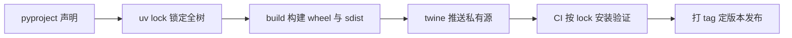

### Q1098 · 语义化版本与发布流程

> 难度:★★★☆ | 标签:semver, 发布

**问**:版本号 1.4.2 与 2.0.0-rc.1 的区别是什么?发布流程怎么跟版本号联动?

**答**:语义化版本 MAJOR.MINOR.PATCH:MAJOR 破坏兼容、MINOR 向后兼容的新功能、PATCH 修复;pre-release(alpha/beta/rc)排在正式版之前,供灰度验证。流程联动:CI 从分支/tag 推导版本(提交信息或 tag 触发),打 tag 即构建 wheel 并推送私有源,rc 先发测试渠道,验证后转正式。规则要写进 CONTRIBUTING 并用工具(如 commitizen)从提交信息自动 bump,杜绝手工改版本的漂移。依赖声明里 `~1.4` 与 `>=1.4,<2` 的含义也要能解释。

```python
# file: code/05_数据分析与工程化/q1098_semver.py
import re

SEMVER = re.compile(r"^(\d+)\.(\d+)\.(\d+)(?:-([0-9A-Za-z.-]+))?$")
PRE_RANK = {"alpha": 0, "beta": 1, "rc": 2}

def version_key(v):
    m = SEMVER.match(v)
    if not m:
        raise ValueError(f"非法版本号: {v}")
    major, minor, patch, pre = m.groups()
    if pre is None:
        return (int(major), int(minor), int(patch), 3, "")
    return (int(major), int(minor), int(patch), PRE_RANK.get(pre.split(".")[0], -1), pre)

if __name__ == "__main__":
    vs = ["1.0.0", "1.0.0-rc.1", "1.0.0-beta", "1.0.0-alpha", "0.9.9"]
    for v in sorted(vs, key=version_key):
        print(v)
    assert version_key("1.0.0-alpha") < version_key("1.0.0-beta") < version_key("1.0.0") 
    print("pre-release 排在正式版之前,tag 驱动构建即发布")
```

**追问**:
- 追问 1:0.x 版本的语义约定?—— 0.x 视为开发期,MINOR 也可能破坏兼容,依赖它要锁死版本。
- 追问 2:怎么自动决定 bump 哪一位?—— commit 规范(feat/fix/breaking)+ 工具解析,breaking 用 `!` 或 footers 声明。


