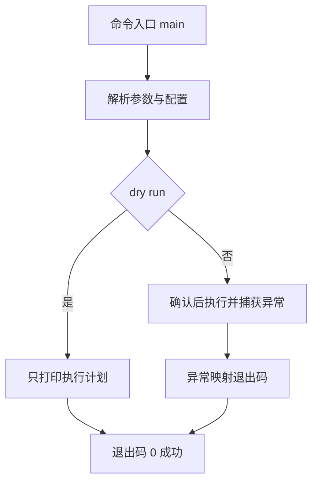

### Q1101 · 机器可读输出 --json 与管道友好

> 难度:★★☆☆ | 标签:CLI, 设计

**问**:人要看表格,脚本要解析输出,同一个 CLI 怎么同时伺候两类用户?

**答**:输出双模:默认人类模式(对齐表格、颜色、进度),`--json` 切机器模式(单对象或行分隔 JSON,无颜色无进度条)。原则:机器模式的 stdout 必须纯净,日志与进度一律走 stderr;结构稳定并写进文档(字段名即契约);错误时输出带 code 字段的结构化错误。管道友好还包括支持 `-o file`、`--quiet`,以及响应 SIGPIPE(head 截断时不报错)。

```python
# file: code/05_数据分析与工程化/q1101_json_output.py
import json
import sys

def collect():
    return [
        {"name": "api", "p95_ms": 120, "error_rate": 0.002},
        {"name": "worker", "p95_ms": 300, "error_rate": 0.0},
    ]

def main(argv):
    data = collect()
    if "--json" in argv:
        json.dump(data, sys.stdout, ensure_ascii=False, indent=2)
        print()
        return 0
    print(f"{'服务':<8}{'p95':>8}{'错误率':>10}")
    for row in data:
        print(f"{row['name']:<8}{row['p95_ms']:>8}{row['error_rate']:>10.3%}")
    return 0

if __name__ == "__main__":
    main(sys.argv[1:])
    print("提示:追加 --json 查看机器可读输出;日志应走 stderr 保持 stdout 纯净")
```

**追问**:
- 追问 1:为什么进度条必须走 stderr?—— stdout 承载数据,进度混入会污染管道与重定向,jq/curl 的设计同样如此。
- 追问 2:JSON 模式下错误怎么表达?—— 退出码非 0 + stderr 或 JSON 里的 error 对象,两者都要有,方便人和脚本。


