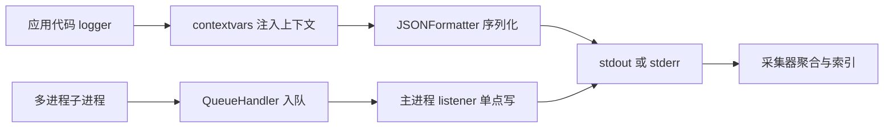

### Q1104 · 日志降噪:采样、分级与限流

> 难度:★★★☆ | 标签:logging, 可观测性

**问**:重试风暴时日志把磁盘打满,告警淹没在噪音里,怎么给日志装上"节流阀"?

**答**:三种机制叠加:分级(TRACE/DEBUG 只在排障时开,生产 INFO 起)、采样(同构事件每 N 条记 1 条,如成功请求 1/100)、限流(同一 key 在时间窗口内最多 M 条,超出丢弃并周期性汇总"已抑制 N 条")。实现上是 logger 前的一层过滤器,按消息 key(如 user_id+错误码)维护滑动窗口计数。原则:错误日志不采样(或低采样率),成功路径大胆采样;抑制信息本身要可见,否则排障时会误以为"什么都没发生"。

```python
# file: code/05_数据分析与工程化/q1104_log_throttle.py
import collections
import time

class LogThrottle:
    def __init__(self, window=60, max_per_window=3):
        self.window = window
        self.max = max_per_window
        self.recent = collections.defaultdict(collections.deque)
        self.suppressed = collections.Counter()

    def allow(self, key):
        now = time.monotonic()
        dq = self.recent[key]
        while dq and now - dq[0] > self.window:
            dq.popleft()
        if len(dq) < self.max:
            dq.append(now)
            return True
        self.suppressed[key] += 1
        return False

if __name__ == "__main__":
    throttle = LogThrottle(window=60, max_per_window=2)
    for i in range(10):
        if throttle.allow("user42:timeout"):
            print(f"记录第 {i + 1} 条超时日志")
    print("窗口内被抑制:", dict(throttle.suppressed), "条,周期性汇总打出")
```

**追问**:
- 追问 1:采样和限流的区别?—— 采样按比例留代表性样本,限流按窗口封顶防打爆,通常限流兜底、采样常规。
- 追问 2:被抑制的日志完全丢了吗?—— 只丢正文,计数保留,周期输出"同类事件抑制 N 条"维持可观测性。


