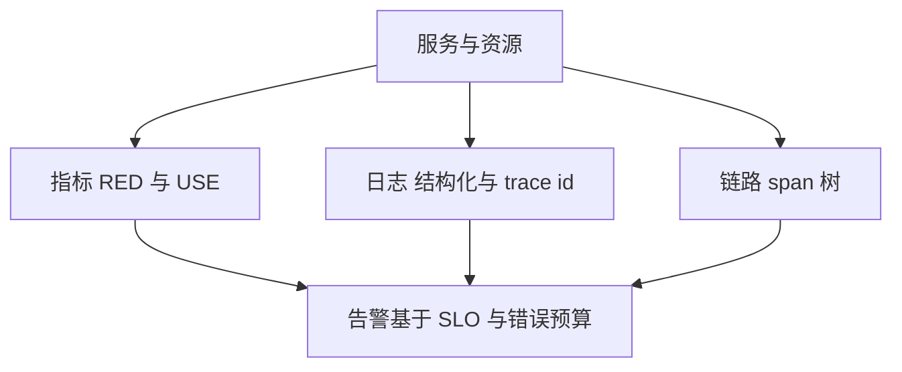

### Q1108 · RED 与 USE 黄金指标

> 难度:★★★☆ | 标签:可观测性, 方法论

**问**:接手一个服务,仪表盘该放哪些图?有没有方法论?

**答**:两个互补框架。RED 面向请求驱动服务:Rate 每秒请求数、Errors 错误率、Duration 延迟分布,回答"服务是否健康";USE 面向资源:Utilization 使用率、Saturation 饱和度(排队)、Errors 错误,回答"资源是否吃紧"。组合用法:每个服务一张 RED 面板,每个关键资源(DB 连接池、磁盘 IO)一张 USE 面板;谷歌四信号(延迟、流量、错误、饱和度)是两者的并集。要点是指标少而准,面板回答问题而不是堆图。

```python
# file: code/05_数据分析与工程化/q1108_red_use.py

SERVICES = {
    "api": {"Rate": "http_requests_per_s", "Errors": "5xx_per_s", "Duration": "p99_ms"},
    "worker": {"Rate": "jobs_per_s", "Errors": "failed_jobs_per_s", "Duration": "job_p99_ms"},
}
RESOURCES = {
    "db": {"Utilization": "conn_pool_used_ratio", "Saturation": "wait_queue_len", "Errors": "deadlocks_per_s"},
    "disk": {"Utilization": "used_ratio", "Saturation": "io_wait", "Errors": "io_errors_per_s"},
}

def panel(scope, metrics):
    print(f"[{scope}]")
    for k, v in metrics.items():
        print(f"  {k:<12} -> {v}")

if __name__ == "__main__":
    for s, m in SERVICES.items():
        panel(f"RED 服务 {s}", m)
    for r, m in RESOURCES.items():
        panel(f"USE 资源 {r}", m)
    print("四信号:延迟 流量 错误 饱和度,面板要回答问题而不是堆图")
```

**追问**:
- 追问 1:worker 这类非请求驱动服务怎么套 RED?—— 把 Rate 换成吞吐(任务/秒),Duration 换单任务处理时长,框架不变。
- 追问 2:饱和度和使用率的区别?—— 使用率是占用比例,饱和度是"还有多少排队等着",后者才是容量告急的领先信号。


