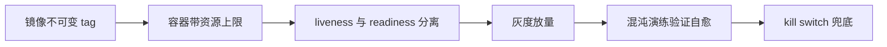

### Q1114 · 镜像标签策略与不可变部署

> 难度:★★★☆ | 标签:Docker, 部署

**问**:生产上引用 app:latest 会出什么事?正确的镜像版本策略是什么?

**答**:latest 是可变引用,两台机器两次拉取可能拿到不同构建,"同一个 latest"无法回滚也无法审计。正确策略:每次构建产出不可变引用——语义版本 tag(app:1.4.2)或版本+日期,最强保证是 digest(app@sha256:...),部署清单引用不可变 tag;latest 只在本地开发用。配套:CI 构建即打 tag 推镜像仓库,部署时用 digest 校验,回滚即回指上一个 tag。这就是不可变基础设施在镜像层的落点:不修改,只替换。

```python
# file: code/05_数据分析与工程化/q1114_image_tags.py

TAGS = {
    "app:latest": "会漂移,禁止在生产引用",
    "app:1.4.2": "语义版本,推荐",
    "app:1.4.2-20261101": "版本+日期,可追溯构建时间",
    "app@sha256:abc123": "digest 级不可变,最强保证",
}

def deploy_ref(ref):
    if ref.endswith(":latest"):
        raise ValueError("生产禁止 latest")
    return f"kubectl set image deploy/app {ref}"

if __name__ == "__main__":
    for t, note in TAGS.items():
        print(f"{t:<24} {note}")
    print(deploy_ref("app:1.4.2"))
    try:
        deploy_ref("app:latest")
    except ValueError as e:
        print("已拦截:", e)
```

**追问**:
- 追问 1:回滚具体回什么?—— 回指上一个已知好的不可变 tag/digest,而不是重建,前提是镜像仓库保留历史版本。
- 追问 2:tag 被覆盖推送怎么办?—— 镜像仓库开启不可变 tag 策略,或部署直接用 digest,让覆盖失效。


