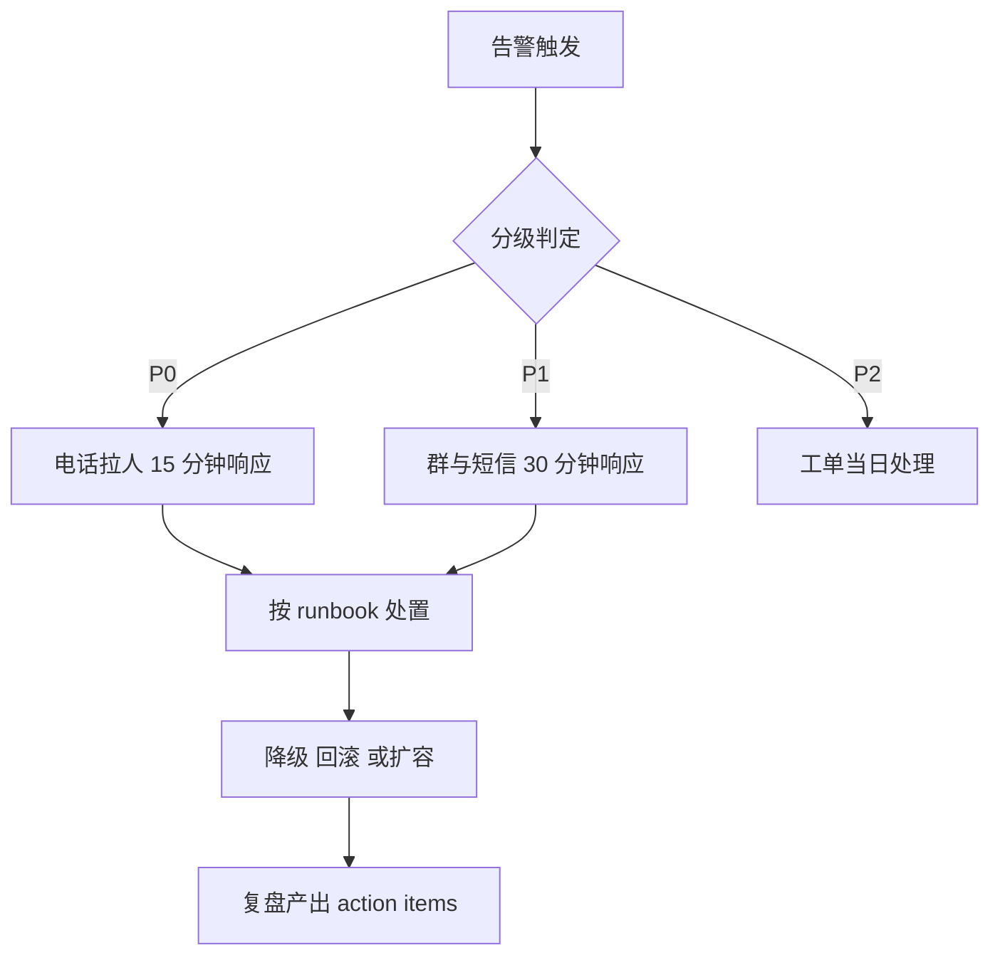

### Q1121 · 特性开关与 kill switch

> 难度:★★★★ | 标签:feature flag, 发布

**问**:新功能上线 10 分钟发现问题,重新发版要 40 分钟,怎么办?

**答**:特性开关把"部署"和"发布"解耦:代码带开关上线(关闭状态),放量时打开开关即发布,出问题 kill switch 秒级关闭,无需发版。实现要点:开关服务(配置中心/自建)带本地缓存与降级默认值(拉不到配置时取保守值);灰度按用户哈希百分比放量,与实验分流同构;开关要有清理机制——发布稳定后移除代码与配置,避免开关僵尸累积成组合爆炸。开关默认值的安全性要评审:默认关,且默认态代码路径可被测试覆盖。

```python
# file: code/05_数据分析与工程化/q1121_feature_flags.py
import hashlib

class Flags:
    def __init__(self):
        self.flags = {}

    def add(self, name, enabled=True, rollout=100):
        self.flags[name] = {"enabled": enabled, "rollout": rollout}

    def is_on(self, name, user_id):
        cfg = self.flags.get(name, {"enabled": False, "rollout": 0})
        if not cfg["enabled"]:
            return False
        digest = hashlib.md5(f"{name}:{user_id}".encode()).hexdigest()
        return int(digest, 16) % 100 < cfg["rollout"]

    def kill(self, name):
        self.flags[name]["enabled"] = False

if __name__ == "__main__":
    f = Flags()
    f.add("new-checkout", enabled=True, rollout=20)
    hits = sum(f.is_on("new-checkout", f"u{i}") for i in range(1000))
    print(f"灰度 20%,命中 {hits} 人")
    f.kill("new-checkout")
    print("kill switch 后:", f.is_on("new-checkout", "u1"))
```

**追问**:
- 追问 1:开关和 A/B 实验的关系?—— 同一套分流机制,实验强调"测效应",开关强调"控发布",实验平台常直接复用开关层。
- 追问 2:开关僵尸有什么危害?—— 代码分支组合指数级增长,无法全测、心智负担大,发布稳定后必须清理。


