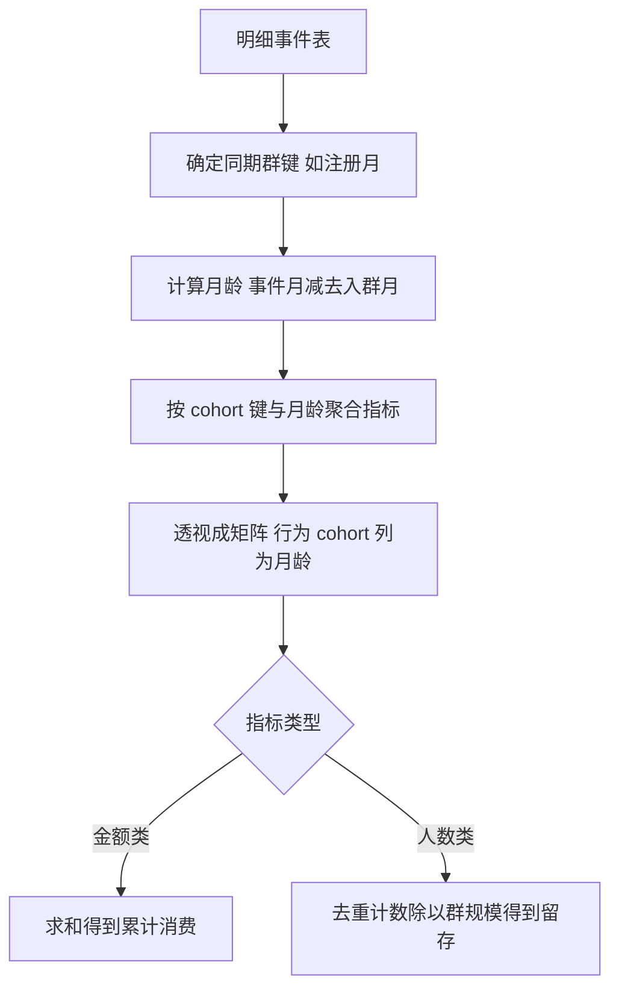

### Q1440 · 同期群分析:通用 cohort 引擎

> 难度:★★★☆ | 标签:同期群, 留存

**问**:让你从零实现一个同期群分析工具,支持任意 cohort 键和任意指标,怎么设计?

**答**:抽象成三个正交概念:cohort 键(注册月、首单日、获客渠道)、月龄(事件时间减 cohort 时间,按月或天)、聚合指标(金额求和、人数去重、次数计数)。引擎先把明细规整成"cohort 键 + 月龄 + 值"三列,再按这两个键透视成矩阵,行是同期群、列是月龄,留存矩阵只是把指标换成"去重人数除以 cohort 规模"的特例。实现上 pandas 的 pivot_table 一行搞定,标准库用双层字典也一样;关键是月龄函数要处理跨年,以及矩阵列数要用观测窗口封顶而不是数据里出现的最大月龄。输出统一带 cohort 规模列,否则横向对比不同大小的 cohort 容易误读。

```python
# file: code/05_数据分析与工程化/q1440_cohort_engine.py
"""同期群引擎:按入群键 x 月龄透视任意指标,pandas 与标准库双实现"""
try:
    import pandas as pd
except ImportError:
    pd = None

EVENTS = [
    # user, signup_month, order_month, amount
    ("u1", "2025-01", "2025-01", 100),
    ("u1", "2025-01", "2025-02", 80),
    ("u2", "2025-01", "2025-01", 200),
    ("u3", "2025-02", "2025-02", 150),
    ("u3", "2025-02", "2025-03", 90),
    ("u4", "2025-02", "2025-03", 60),
]


def month_diff(a, b):
    """b 相对 a 的月龄,格式 YYYY-MM"""
    ya, ma = int(a[:4]), int(a[5:7])
    yb, mb = int(b[:4]), int(b[5:7])
    return (yb - ya) * 12 + (mb - ma)


def cohort_table_stdlib(events, max_age=2):
    """行=同期群,列=月龄,单元格=指标聚合;留存同理把值换成人数即可"""
    agg, sizes = {}, {}
    for user, signup, order, amount in events:
        age = month_diff(signup, order)
        agg[(signup, age)] = agg.get((signup, age), 0) + amount
        sizes.setdefault(signup, set()).add(user)
    cohorts = sorted({k[0] for k in agg})
    print("cohort\t" + "\t".join(f"M{m}" for m in range(max_age + 1)) + "\t用户数")
    for c in cohorts:
        row = [agg.get((c, m), 0) for m in range(max_age + 1)]
        print(c + "\t" + "\t".join(str(v) for v in row) + f"\t{len(sizes[c])}")


if pd is None:
    print("标准库降级:cohort 消费金额矩阵")
    cohort_table_stdlib(EVENTS)
else:
    df = pd.DataFrame(EVENTS, columns=["user", "signup", "order", "amount"])
    df["month_idx"] = df.apply(lambda r: month_diff(r["signup"], r["order"]), axis=1)
    pivot = df.pivot_table(index="signup", columns="month_idx", values="amount",
                           aggfunc="sum", fill_value=0)
    print(pivot)
    print("各 cohort 用户数:", df.groupby("signup")["user"].nunique().to_dict())
```



**追问**:
- 追问 1:cohort 键和留存窗口不一致会怎样?—— 月龄为负的事件要过滤掉,否则会把入群前的行为算进去,矩阵出现负值。
- 追问 2:月龄粒度想按周怎么改?—— 把月龄函数换成天数整除 7,同时 cohort 键对齐到周一,避免周口径错位。
