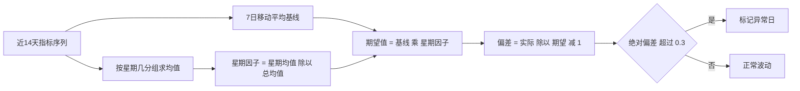

### Q1445 · 趋势基线与季节性识别

> 难度:★★☆☆ | 标签:时间序列, 基线

**问**:日报说"今天的 PV 比昨天低 20%",你怎么判断这算不算异常?

**答**:和昨天比是最差的基线,正确做法是"移动平均基线 x 季节因子":先用近 7 天或 14 天的移动平均建立趋势基线,再按星期几分组算季节因子(该星期均值 / 总体均值),工作日和周末的流量模式完全不同,期望值等于基线乘以当天星期因子,最后用实际值对期望值的偏差判异常。这样"周一比周日跌 20%"不会被误报,而"周三比典型周三跌 20%"才会。趋势与季节分离后还能看纯趋势:排除星期效应后的基线在爬升还是下滑,这比单日波动重要得多。数据里有大促脉冲时,基线窗口要剔除或缩尾,否则季节因子会被脉冲污染。这套逻辑几十行标准库就能落地,不必上来就用 STL 分解。

```python
# file: code/05_数据分析与工程化/q1445_trend_season.py
"""趋势基线与季节性识别:移动平均基线 x 星期因子,异常日一目了然"""
try:
    import pandas as pd
except ImportError:
    pd = None

import datetime as dt

BASE = 1000
DAYS = [(dt.date(2025, 6, 2) + dt.timedelta(days=i),
         int(BASE * (1 + 0.4 * ((dt.date(2025, 6, 2) + dt.timedelta(days=i)).weekday() >= 5))
             + (i * 37 % 60) - 30)) for i in range(14)]
DAYS.append((dt.date(2025, 6, 16), 480))  # 注入一个异常低点


def weekday_factor(days):
    """星期因子 = 该星期均值 / 全体均值,滚动窗口越长越稳"""
    overall = sum(v for _, v in days) / len(days)
    buckets = {}
    for d, v in days:
        buckets.setdefault(d.weekday(), []).append(v)
    return {wd: sum(vs) / len(vs) / overall for wd, vs in buckets.items()}


def stdlib_version(days, window=7):
    factors = weekday_factor(days[:-1])
    print("date        actual  expected  偏差")
    for i, (d, v) in enumerate(days):
        if i < window:
            continue
        history = [v2 for _, v2 in days[i - window:i]]
        expected = (sum(history) / len(history)) * factors[d.weekday()]
        dev = v / expected - 1
        flag = "  <-- 异常" if abs(dev) > 0.3 else ""
        print(f"{d}  {v:>6}  {expected:>8.0f}  {dev:+.0%}{flag}")


if pd is None:
    print("标准库降级:移动平均 x 星期因子")
    stdlib_version(DAYS)
else:
    s = pd.Series({d: v for d, v in DAYS}).sort_index()
    factor = s.groupby(s.index.weekday).mean() / s.mean()
    baseline = s.rolling(7).mean().shift(1) * s.index.map(factor)
    dev = s / baseline - 1
    out = dev[dev.abs() > 0.3]
    print("pandas 结果:异常日")
    print(out.dropna().to_string())
```

**追问**:
- 追问 1:节假日怎么处理?—— 维护节假日表,假日的期望值用"历史同假日"或工作日因子单独估算,不与普通星期混算。
- 追问 2:窗口取多长?—— 覆盖至少两个完整周期(周粒度至少 14 天),太短则季节因子噪声大,太长则趋势被抹平。


