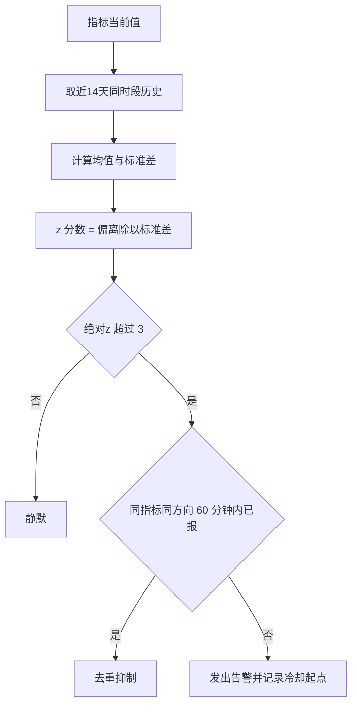

### Q1450 · 指标突变检测:基线与告警去重

> 难度:★★★☆ | 标签:异常检测, 告警治理

**问**:你配了 100 条指标告警,结果天天被告警轰炸,怎么办?

**答**:两头治。检测端用统计基线而不是固定阈值:取近 14 天同时段(按星期几对齐)计算均值和标准差,当前值偏离超过 3 个标准差才触发,这样能自动适应工作日/周末和自然增长,大幅减少"周一低谷也报警"的噪声。告警端做去重与冷却:同一指标同一方向的告警在冷却窗口(比如 60 分钟)内只发一次,避免一个故障刷出 50 条;同时告警要带上下文——当前值、基线均值、z 分数、方向,值班的人不用二次查询就能判断严重度。进一步治理要区分告警的"可行动性":收到后没有任何动作可做的告警直接删掉,高频但低价值的降级为日报条目。指标监控的目标不是"报得多"而是"报的每条都值得人抬头"。

```python
# file: code/05_数据分析与工程化/q1450_metric_anomaly.py
"""指标突变检测:同时段基线 + 报警去重,避免告警风暴"""

import statistics
from datetime import datetime, timedelta

# 指标近14天同时段取值(按星期几对齐,减少周期干扰)
HISTORY = {
    "gmv": [820, 810, 830, 815, 825, 840, 818, 822, 809, 831, 817, 826, 833, 821],
    "dau": [52000, 51800, 52100, 51900, 52300, 52000, 51950, 52150, 51850,
            52200, 52050, 51900, 52350, 52080],
}
TODAY = {"gmv": 640, "dau": 51700}
ALARM_SIGMA = 3.0
COOLDOWN_MINUTES = 60


def detect(name, history, current, k=ALARM_SIGMA):
    mean = statistics.mean(history)
    std = statistics.pstdev(history)
    if std == 0:
        return None
    z = (current - mean) / std
    if abs(z) <= k:
        return None
    return {"metric": name, "value": current, "mean": round(mean, 1),
            "z": round(z, 2), "direction": "spike" if z > 0 else "drop"}


def dedup(alerts, last_sent, now):
    """同一指标同方向在冷却期内只报一次,防告警风暴"""
    sent = []
    for a in alerts:
        key = (a["metric"], a["direction"])
        if now - last_sent.get(key, datetime.min) >= timedelta(minutes=COOLDOWN_MINUTES):
            last_sent[key] = now
            sent.append(a)
    return sent


if __name__ == "__main__":
    now = datetime(2025, 6, 16, 10, 0)
    alerts = [a for a in (detect(k, v, TODAY[k]) for k, v in HISTORY.items()) if a]
    last_sent = {}
    print("第一轮告警:", dedup(alerts, last_sent, now))
    print("冷却期内重复告警:", dedup(alerts, last_sent, now + timedelta(minutes=10)), "-> 被抑制")
    print("冷却期后再次告警:", dedup(alerts, last_sent, now + timedelta(minutes=61)))
```



**追问**:
- 追问 1:标准差对重尾指标失效怎么办?—— 改用 MAD 或分位数基线,或先对指标取对数再算 z 分数。
- 追问 2:故障恢复时会不会误报 spike?—— 会,恢复值可能反向偏离基线,所以告警要带方向和恢复识别,连续两期回归基线内自动关闭。
