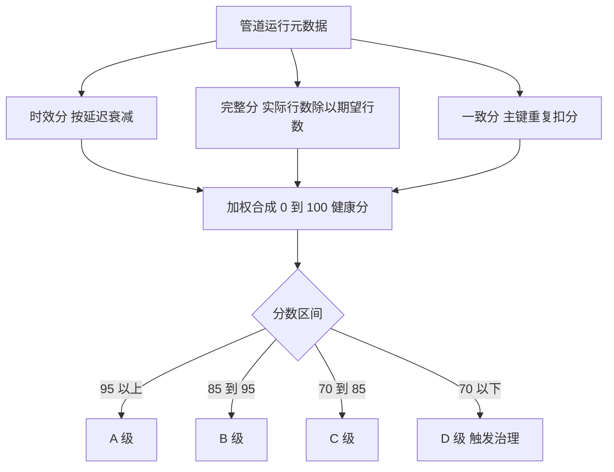

### Q1455 · 管道健康分模型

> 难度:★★★☆ | 标签:可观测性, 健康分

**问**:老板让你给所有数据管道搞一个"健康度",你怎么定义一个 0-100 的分数让人信服?

**答**:把健康拆成三个可独立测量的分量再加权:时效分(实际完成时刻相对计划时刻,准时满分,宽限期外按分钟线性衰减)、完整分(实际行数 / 期望行数,期望值用"上游行数"或"昨日同期"两种口径)、一致分(主键重复数、跨表对账差异数,零重复满分)。权重按业务痛感分配,时效 40%、完整 35%、一致 25% 是常见起点,加权合成 0-100 分并映射 A-D 级。健康分的关键不在公式而在用途:它是按天画趋势的治理仪表盘,连续三天降级自动开工单,而不是用来考核个人。每个分量的失分明细必须可展开——看到 72 分要能立刻知道是哪个表、哪个分量扣的,否则分数就是个装饰。分量定义写进文档并保持稳定,改公式要走评审,否则分数失去跨期可比性。

```python
# file: code/05_数据分析与工程化/q1455_pipeline_health.py
"""管道健康分:时效、完整、一致三项加权,输出 0-100 与分级"""

import datetime as dt

PIPELINES = [
    # name, 计划完成时刻, 实际完成时刻, 期望行数, 实际行数, 主键重复数
    ("ods_order", dt.time(2, 0), dt.time(2, 5), 100000, 99998, 0),
    ("dwd_order", dt.time(3, 0), dt.time(3, 40), 100000, 100000, 12),
    ("ads_funnel", dt.time(4, 0), dt.time(4, 1), 5000, 5000, 0),
]

WEIGHTS = {"freshness": 0.4, "completeness": 0.35, "consistency": 0.25}


def freshness_score(planned, actual, grace_minutes=10):
    """晚于计划即扣分,宽限期外按每分钟线性衰减,60 分钟归零"""
    delay = (dt.datetime.combine(dt.date(2025, 6, 16), actual)
             - dt.datetime.combine(dt.date(2025, 6, 16), planned)).total_seconds() / 60
    if delay <= 0:
        return 1.0
    return max(0.0, 1 - max(0.0, delay - grace_minutes) / 60)


def completeness_score(expected, actual):
    return min(1.0, actual / expected) if expected else 1.0


def consistency_score(dup_keys):
    return 1.0 if dup_keys == 0 else max(0.0, 1 - dup_keys / 1000)


def health_score(row):
    name, planned, actual, expected, actual_rows, dups = row
    parts = {
        "freshness": freshness_score(planned, actual),
        "completeness": completeness_score(expected, actual_rows),
        "consistency": consistency_score(dups),
    }
    total = sum(parts[k] * WEIGHTS[k] for k in parts) * 100
    grade = "A" if total >= 95 else "B" if total >= 85 else "C" if total >= 70 else "D"
    return name, round(total, 1), grade, {k: round(v, 3) for k, v in parts.items()}


if __name__ == "__main__":
    for name, total, grade, parts in map(health_score, PIPELINES):
        print(f"{name}: {total} 分 [{grade}] 明细 {parts}")
    print("健康分进看板并按日趋势展示,连续三天降级要触发治理工单")
```



**追问**:
- 追问 1:期望行数怎么定才公平?—— 用上游实际行数而非硬编码,上游波动时下游不应背锅,完整分退化为"对账差率"。
- 追问 2:权重怎么校准?—— 用历史事故回放:出过事故的失分模式在旧公式下应能命中低分,否则调权重直到历史事故可被识别。
