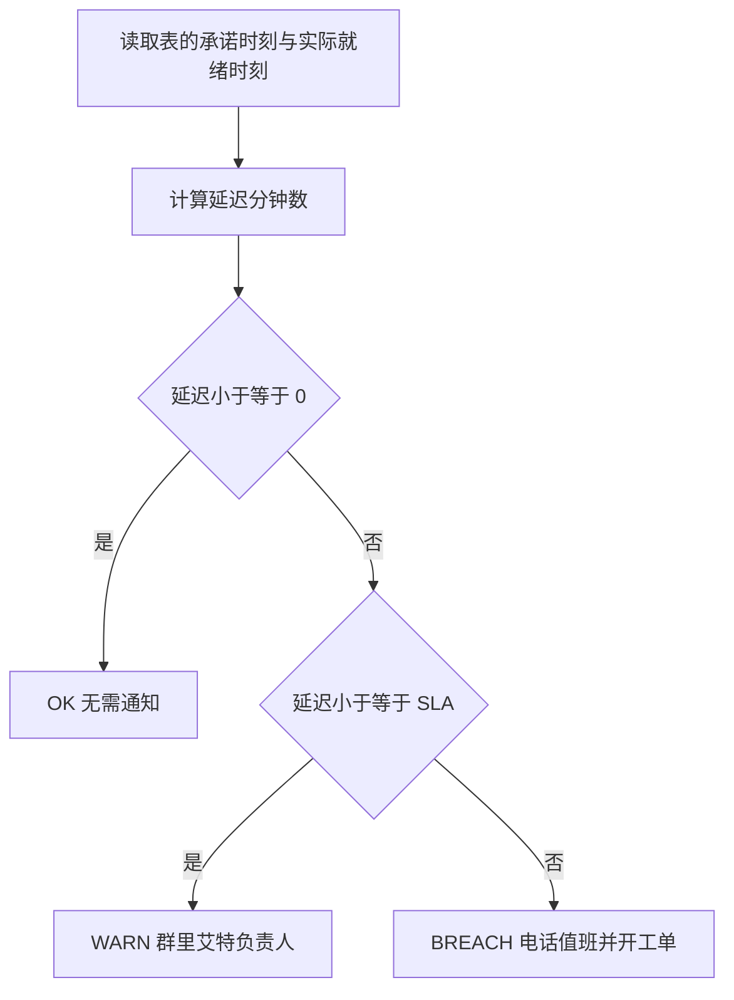

### Q1460 · 数据新鲜度 SLA 与分级通知

> 难度:★★☆☆ | 标签:SLA, 新鲜度

**问**:数据用户说"报表早上没出来",这句话怎么变成一个可执行的工程契约?

**答**:把新鲜度写成 SLA:每张核心表登记"承诺就绪时刻"和"最大可容忍延迟分钟数",监控侧每天对比实际就绪时刻与承诺时刻,得到延迟分钟数,再分三级处置——未到承诺时刻为 OK;已延迟但在 SLA 内为 WARN,群里艾特负责人即可;超过 SLA 为 BREACH,电话值班并自动开工单。三个工程细节:承诺时刻要用"业务可用时刻"而不是"任务计划完成时刻",中间留出校验和修复的时间;SLA 按表分级,老板每天看的核心报表和月度归档表不能共用一个时限;违约率按周统计进团队健康报告,让数据可靠性成为被度量的指标而不是体感。这个机制的意义是把"数据没出来"从扯皮变成有据可查的契约履行问题。

```python
# file: code/05_数据分析与工程化/q1460_freshness_sla.py
"""数据新鲜度 SLA:每表时限、延迟分级与联系人路由"""

import datetime as dt

TABLES = [
    # 表, 承诺时刻, 实际就绪时刻, SLA 分钟, 负责人
    ("ads_realtime", dt.time(0, 15), dt.time(0, 12), 15, "实时组"),
    ("dwd_trade", dt.time(3, 0), dt.time(3, 20), 15, "数仓组"),
    ("ads_report", dt.time(8, 0), dt.time(7, 30), 30, "报表组"),
]


def lag_minutes(planned, actual, day=dt.date(2025, 6, 16)):
    delta = dt.datetime.combine(day, actual) - dt.datetime.combine(day, planned)
    return delta.total_seconds() / 60


def grade(lag, sla):
    if lag <= 0:
        return "OK"
    if lag <= sla:
        return "WARN 已延迟但在 SLA 内"
    return "BREACH 违约"


if __name__ == "__main__":
    for name, planned, actual, sla, owner in TABLES:
        lag = lag_minutes(planned, actual)
        g = grade(lag, sla)
        notify = "电话值班" if g.startswith("BREACH") else \
                 ("群里 @负责人" if g.startswith("WARN") else "无需通知")
        print(f"{name}: 延迟 {lag:+.0f} 分钟 SLA {sla} -> {g} 通知: {notify}")
    print("新鲜度 SLA 要写进服务目录,违约率按周统计进团队健康报告")
```



**追问**:
- 追问 1:承诺时刻定得宽松还是紧?—— 定用户真实需要的时刻,再反推管道计划时刻;把 SLA 定成管道"碰巧能跑到的时间"是本末倒置。
- 追问 2:提前跑完算不算违约?—— 不算,但要警惕"比上游源数据还早"的表,那可能是读了旧分区,新鲜度监控要配对账。
