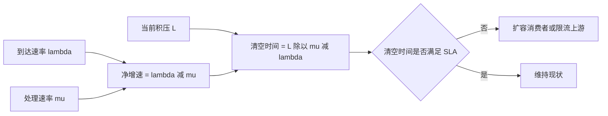

### Q1465 · 积压估算与容量规划

> 难度:★★★☆ | 标签:容量规划, 排队论

**问**:Kafka 消费积压 60 万条,老板问"什么时候能追平",你不许说"看情况"。

**答**:用排队论的最小工具 Little 定律算,三个数就够:到达速率 lambda、处理速率 mu、当前积压 L。净增速 = lambda - mu:为正则积压持续增长,任何时刻的积压 = 当前积压 + 净增速 x 时间;为负才能清空,清空时间 = L / (mu - lambda)。老板问"两小时内追平"就反推所需处理速率 = lambda + L / 时限,拿这个数和现有容量对比,差距就是需要扩容的量。这套算术的价值是把容量讨论从拍脑袋变成可验证的数字:扩容多少实例、每个实例处理速率多少、ETA 几点,全部可提前算出并可事后验证。要强调假设前提:到达和处理速率要在观察期内稳定,大促流量是阶跃型,要按峰值 lambda 而不是均值算,否则 ETA 全部过于乐观。

```python
# file: code/05_数据分析与工程化/q1465_backlog_estimation.py
"""积压估算:Little 定律与清空时间,容量规划的最小工具"""

import math

SCENARIOS = [
    # 场景, 到达速率 行/秒, 处理速率 行/秒, 当前积压 行
    ("稳态", 800, 1000, 0),
    ("积压增长", 1200, 1000, 0),
    ("故障后追赶", 800, 1000, 600000),
]


def estimate(in_rate, out_rate, backlog):
    growth = in_rate - out_rate
    if growth <= 0 and backlog == 0:
        return {"state": "稳态", "drain_hours": 0.0, "backlog_1h": 0}
    backlog_1h = max(0, backlog + growth * 3600)
    if growth < 0:
        drain_hours = backlog / (-growth) / 3600
        return {"state": "清空中", "drain_hours": round(drain_hours, 2),
                "backlog_1h": backlog_1h}
    return {"state": "持续积压", "drain_hours": math.inf,
            "backlog_1h": backlog_1h}


def required_out_rate(in_rate, backlog, deadline_hours):
    """给定清理时限反推需要的处理速率"""
    return in_rate + backlog / (deadline_hours * 3600)


if __name__ == "__main__":
    for name, r_in, r_out, backlog in SCENARIOS:
        r = estimate(r_in, r_out, backlog)
        print(f"{name}: {r}")
    need = required_out_rate(800, 600000, 2)
    print(f"2 小时内清完 60 万积压需要处理速率 {need:.0f} 行/秒")
    print("要点:容量规划就是 Lambda/W 的算术,先算清楚再谈扩容")
```



**追问**:
- 追问 1:消费者扩容就一定有效吗?—— 不一定,瓶颈常在下游库写入或分区数上限,扩容前先确认瓶颈在哪一段,分区数决定了并行度上限。
- 追问 2:积压里新旧数据要区别对待吗?—— 要,超过最大延迟的旧消息可以按策略丢弃并记录,全量追赶反而会把过期数据写进当前窗口。
