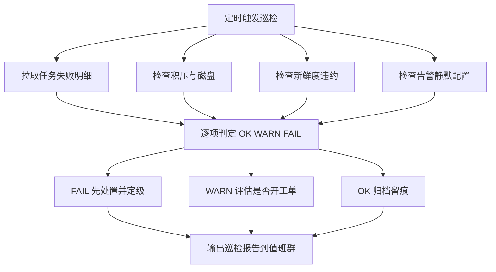

### Q1470 · 值班巡检脚本

> 难度:★★★☆ | 标签:值班, 巡检

**问**:值班的人每天早上要花一小时"看看有没有事",你怎么把这一小时自动化?

**答**:写巡检脚本把"看"变成"跑":聚合多类健康信号——夜间任务失败明细、管道积压量、存储使用率、核心表新鲜度违约、告警静默配置变化——每项检查输出三态 OK/WARN/FAIL,FAIL 项附带建议动作,汇总成一份可以直接贴进值班群的报告。设计原则:巡检项必须是"可行动"的,判定函数返回的不只是状态还有"下一步做什么";结果按严重度排序,FAIL 在最上,值班的人只看头部就能开始干活;巡检本身要幂等无副作用,只读不写。进阶做法是把巡检接入发布与变更日历:"昨天有发布"的巡检自动加一节"发布后指标对比",把例行检查与事件上下文关联。巡检脚本的价值是把经验制度化:老值班脑子里的检查清单,变成新人也能执行的代码。

```python
# file: code/05_数据分析与工程化/q1470_oncall_patrol.py
"""值班巡检脚本:聚合多类健康信号,输出一份可行动的巡检报告"""

import datetime as dt

NOW = dt.datetime(2025, 6, 16, 9, 0)

CHECKS = [
    # 检查项, 取值函数, 判定函数 -> 状态与建议
    ("夜间任务失败数", lambda: 3,
     lambda v: ("FAIL", "列出失败任务并逐个定级") if v > 0 else ("OK", "")),
    ("管道积压行数", lambda: 150000,
     lambda v: ("WARN", "评估清空时间,必要时扩容") if v > 100000 else ("OK", "")),
    ("数仓磁盘使用率", lambda: 0.91,
     lambda v: ("WARN", "触发归档清理") if v > 0.85 else ("OK", "")),
    ("核心表新鲜度违约数", lambda: 1,
     lambda v: ("FAIL", "按 SLA 电话通知负责人") if v > 0 else ("OK", "")),
    ("告警静默规则数", lambda: 0,
     lambda v: ("WARN", "检查是否有人误加静默") if v > 0 else ("OK", "")),
]


def patrol():
    report = {"FAIL": [], "WARN": [], "OK": []}
    for name, getter, judge in CHECKS:
        value = getter()
        status, advice = judge(value)
        report[status].append((name, value, advice))
    return report


if __name__ == "__main__":
    report = patrol()
    print(f"值班巡检报告 {NOW:%Y-%m-%d %H:%M}")
    for status in ("FAIL", "WARN", "OK"):
        for name, value, advice in report[status]:
            suffix = f" -> {advice}" if advice else ""
            print(f"[{status}] {name} = {value}{suffix}")
    print("\n结论:先处理 FAIL 再看 WARN;报告直接贴进值班群")
```



**追问**:
- 追问 1:巡检和告警的边界?—— 告警是实时触发的异常,巡检是定时汇总的例行体检;巡检能覆盖"没触发任何告警但整体在劣化"的盲区。
- 追问 2:巡检项越来越多怎么治理?—— 每季度审一遍,连续 30 天全 OK 且无行动价值的项合并进日报,保持巡检项的信噪比。
