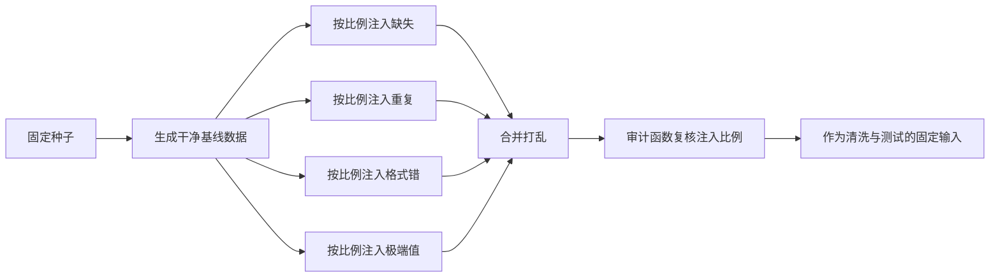

### Q1475 · 故障注入测试数据生成

> 难度:★★★★ | 标签:故障注入, 测试数据

**问**:你的清洗逻辑在真实数据上天天崩,测试时却全绿。测试数据的问题出在哪?

**答**:测试数据太干净。真实数据必然包含:缺失(null 和"看起来不是 null 的缺失"如 "N/A")、类型混乱(数字存成字符串、日期多种格式)、重复(整行重复和主键重复)、极端值(-999 哨兵值、录入错误),还有编码与空白字符问题。解法是故障注入生成器:以固定种子从干净基线出发,按可配置比例注入各类缺陷,产出"已知缺陷密度"的脏数据集,这样测试就变成可断言的——清洗逻辑跑完后,各类缺陷的清除率可以精确验证,而不是只看"没抛异常"。三个关键性质:可复现(同种子必同数据,bug 报告可附带数据集)、密度可控(接近生产真实比例,不能 50% 缺失练出过拟合的清洗代码)、自带审计函数(审计函数同时就是清洗逻辑的验收器)。这和 chaos engineering 是同一思想在数据层的投影:主动制造故障,换取对故障的免疫力。

```python
# file: code/05_数据分析与工程化/q1475_fault_injection_data.py
"""故障注入测试数据生成:向干净数据注入缺失、重复、格式错与极端值"""

import random

random.seed(20250616)

CLEAN = [
    {"user_id": i, "age": 18 + i % 40, "city": ["北京", "上海", "广州"][i % 3]}
    for i in range(20)
]


def inject(rows, null_rate=0.1, dup_rate=0.05, corrupt_rate=0.1, outlier_rate=0.05):
    rng = random.Random(42)
    out = []
    for row in rows:
        r = dict(row)
        if rng.random() < null_rate:
            r["age"] = None
        if rng.random() < corrupt_rate:
            r["age"] = rng.choice(["二十", "N/A", "18.5.1"])
        if rng.random() < outlier_rate:
            r["age"] = rng.choice([-999, 9999])
        out.append(r)
    n_dup = int(len(out) * dup_rate)
    out += [dict(rng.choice(out)) for _ in range(n_dup)]
    rng.shuffle(out)
    return out


def audit(rows):
    nulls = sum(1 for r in rows if r["age"] is None)
    corrupt = sum(1 for r in rows if isinstance(r["age"], str))
    outliers = sum(1 for r in rows if isinstance(r["age"], int)
                   and not 0 <= r["age"] <= 120)
    ids = [r["user_id"] for r in rows]
    dupes = len(ids) - len(set(ids))
    return {"nulls": nulls, "corrupt": corrupt, "outliers": outliers, "dupes": dupes}


if __name__ == "__main__":
    dirty = inject(CLEAN)
    print("注入后行数:", len(dirty), "干净行数:", len(CLEAN))
    print("质量审计:", audit(dirty))
    again = inject(CLEAN)
    print("同种子可复现:", dirty == again)
    print("要点:测试数据集必须可复现,审计函数同时就是清洗逻辑的验收器")
```



**追问**:
- 追问 1:注入比例怎么定才贴近现实?—— 从生产数据统计真实缺陷率(按表、按列),生成器参数化到列级,而不是全局一个比例。
- 追问 2:组合缺陷要不要注入?—— 要,同一行既有缺失又有格式错的复合缺陷最容易打崩串行清洗管道,组合按缺陷独立性随机叠加。
