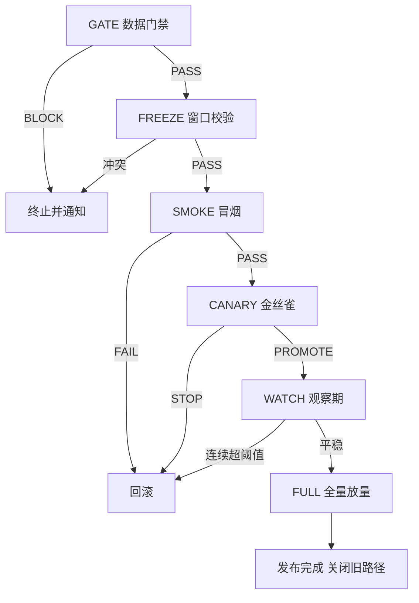

### Q1480 · 综合案例:一次数据发布的完整剧本

> 难度:★★★★ | 标签:发布, 综合案例

**问**:把前面所有题串起来:一次数据服务发布,从代码合并到放量完成,你的完整剧本是什么?中间任何一步失败呢?

**答**:把发布建模成状态机而不是清单,每个状态有明确的成功转移和失败转移:GATE 阶段跑分级数据门禁(断言库 + 血缘影响面),BLOCK 则终止,成本最低;FREEZE 阶段校验发布窗口与冻结期,冲突改期;SMOKE 阶段部署后跑冒烟清单,任一失败立即回滚,此时损失是分钟级;CANARY 阶段小流量金丝雀对比 30 分钟,STOP 信号触发自动回滚,此时影响面限于灰度用户;WATCH 阶段逐日观察期报告,连续超阈值回滚并复盘;FULL 阶段全量放量并关闭旧路径。状态机的要点是每一步的失败路径和成功路径一样被显式定义——大多数发布事故源于"成功剧本很熟、失败剧本空白"。整条链路的原则是:越早的拦截成本越低,所以门禁最严、冒烟要快、金丝雀要有自动决策、观察期要留证据。面试时能按这个顺序完整讲述并指出每步的失败处置,基本就是工程化成熟度的满分答案。

```python
# file: code/05_数据分析与工程化/q1480_release_playbook.py
"""综合案例:一次数据发布的完整剧本,状态机驱动可中断续跑"""

PLAYBOOK = [
    # 阶段, 动作, 失败时的处置
    ("GATE", "跑分级数据测试门禁", "BLOCK 则终止,不进入发布"),
    ("FREEZE", "校验发布窗口与冻结期", "冲突则改期并通知干系人"),
    ("SMOKE", "部署后跑冒烟清单", "任一失败立即回滚"),
    ("CANARY", "小流量金丝雀对比 30 分钟", "STOP 信号则回滚"),
    ("WATCH", "观察期报告逐日巡检", "连续超阈值则回滚并复盘"),
    ("FULL", "全量放量并关闭特性开关旧路径", "问题则按回滚剧本执行"),
]


class Release:
    def __init__(self, version):
        self.version = version
        self.stage_index = 0
        self.history = []

    def run(self, stage_results):
        """stage_results: 每阶段模拟结果, PASS / FAIL"""
        while self.stage_index < len(PLAYBOOK):
            stage, action, failure_plan = PLAYBOOK[self.stage_index]
            result = stage_results.get(stage, "PASS")
            self.history.append((stage, action, result))
            print(f"[{self.version}] {stage}: {action} -> {result}")
            if result == "FAIL":
                print(f"  处置: {failure_plan}")
                print("  执行回滚剧本,发布终止")
                return "ROLLED_BACK"
            self.stage_index += 1
        return "RELEASED"


if __name__ == "__main__":
    print("剧本 A: 顺利发布")
    r1 = Release("v2025.06.2")
    print("结果:", r1.run({}))
    print("\n剧本 B: 金丝雀阶段失败")
    r2 = Release("v2025.06.3")
    print("结果:", r2.run({"CANARY": "FAIL"}))
    print("\n要点:发布是状态机不是清单,每一态的失败路径要和成功路径一样明确")
```



**追问**:
- 追问 1:数据发布和普通服务发布的最大区别?—— 数据发布多一层"历史可回溯性":代码可回滚但已产出的错误数据要靠回填修复,所以门禁前置比什么都重要。
- 追问 2:状态机执行到一半人不在怎么办?—— 每阶段的进入条件与超时策略配置化,超时自动执行默认处置(通常是最保守动作)并升级通知。
