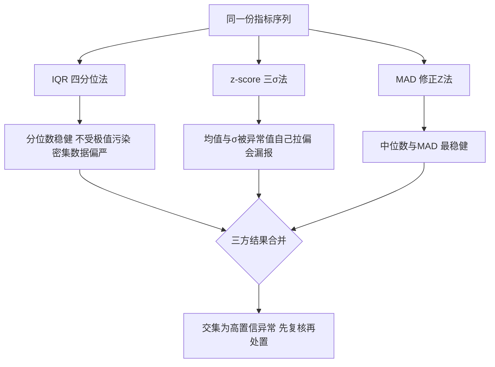

### Q1712 · 异常值三方法对比实测

> 难度:★★★★ | 标签:异常检测, IQR

**问**:数据里怀疑有异常值,IQR、z-score、MAD 三种方法你都用过吗?同一份数据上它们表现差在哪?

**答**:同一份带两个真异常(90 和 130)的数据实测:IQR 用四分位距标出 3 个,连 15 这种正常波动也标了,对密集离散数据偏严;z-score 只标出 130,90 没过 3σ 线,因为均值和标准差被异常值自己拉偏了,这就是掩蔽效应;MAD 修正 Z 精确抓到两个真异常。结论是 z-score 只在近似正态且无极端值时可靠,IQR 和 MAD 基于分位数稳健。选型建议:探索期先 IQR 粗筛,MAD 复核,人工确认业务含义后再处置,处置优先盖帽或分桶而不是直接删除。三种方法都跑出来对比,是排查数据质量最省力的做法。

```python
# file: code/05_数据分析与工程化/q1712_outlier_compare.py
"""异常值三方法实测:IQR、z-score、MAD 在同一份重尾数据上的表现对比"""

DATA = [12, 13, 12, 14, 13, 11, 12, 13, 14, 12,
        13, 12, 15, 13, 12, 13, 14, 12, 13, 12,
        11, 13, 12, 14, 13, 12, 13, 12, 90, 130]  # 末尾两个真异常


def iqr_flags(xs, k=1.5):
    s = sorted(xs)
    n = len(s)
    q1, q3 = s[n // 4], s[3 * n // 4]
    iqr = q3 - q1
    lo, hi = q1 - k * iqr, q3 + k * iqr
    return [x for x in xs if x < lo or x > hi], (q1, q3)


def zscore_flags(xs, z=3.0):
    n = len(xs)
    mean = sum(xs) / n
    std = (sum((x - mean) ** 2 for x in xs) / n) ** 0.5
    return [x for x in xs if abs((x - mean) / std) > z], (round(mean, 1), round(std, 1))


def mad_flags(xs, c=3.5):
    """修正 z = 0.6745*(x-中位数)/MAD,阈值 3.5 是经典取值"""
    med = sorted(xs)[len(xs) // 2]
    mad = sorted(abs(x - med) for x in xs)[len(xs) // 2]
    return [x for x in xs if 0.6745 * abs(x - med) / mad > c], (med, mad)


if __name__ == "__main__":
    for name, fn in [("IQR 1.5 倍", iqr_flags),
                     ("z-score 3σ", zscore_flags),
                     ("MAD 3.5", mad_flags)]:
        out, params = fn(DATA)
        print(f"{name:<12} 参数{params} -> 异常 {len(out)} 个: {sorted(set(out))}")
    print("要点:z-score 的均值与σ被异常值自己污染产生掩蔽,90 可能漏报;IQR 与 MAD 基于分位数,先 IQR 后 MAD 复核,再人工确认")
```



**追问**:
- 追问 1:三种方法结果冲突以谁为准?—— 以 MAD 与 IQR 的并集为候选,人工看业务含义再定,z-score 结果只做参考。
- 追问 2:时间序列怎么用这些方法?—— 按滚动窗口算分位数,用窗口内的分布而不是全历史,近因更能代表当前规律。
