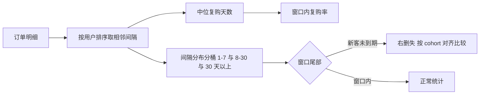

### Q1717 · 复购周期与间隔分布

> 难度:★★☆ | 标签:复购, 分布分析

**问**:复购周期怎么算?复购率为什么必须声明观察窗口?

**答**:复购周期是相邻订单的时间间隔:按用户把订单按时间排序,取相邻差值得到间隔序列,再看中位数和分桶(1-7 天、8-30 天、30 天以上)。中位复购天数直接指导召回时机,中位 12 天的产品第 10 天发券正合适。两个坑:一是复购率必须声明观察窗口,"窗口内有复购的用户占比"不说窗口就是废数;二是窗口尾部的新客还没来得及复购,这叫右删失,按注册 cohort 对齐截止日比较才公平,否则新客占比高的月份复购率永远偏低。间隔分布通常右偏,统计量用中位数和分位数,均值会被重度用户拉偏。

```python
# file: code/05_数据分析与工程化/q1717_repurchase.py
"""复购周期:订单间隔分布、中位复购天数与 30 天复购率"""

from datetime import date

ORDERS = {
    "u1": [date(2025, 8, 1), date(2025, 8, 6), date(2025, 8, 20)],
    "u2": [date(2025, 8, 3), date(2025, 8, 25)],
    "u3": [date(2025, 8, 5)],
    "u4": [date(2025, 8, 2), date(2025, 8, 9), date(2025, 8, 12)],
    "u5": [date(2025, 8, 8), date(2025, 8, 10)],
}


def intervals(ds):
    ds = sorted(ds)
    return [(b - a).days for a, b in zip(ds, ds[1:])]


def median(xs):
    s = sorted(xs)
    n = len(s)
    return s[n // 2] if n % 2 else (s[n // 2 - 1] + s[n // 2]) / 2


if __name__ == "__main__":
    all_iv = []
    for u, ds in ORDERS.items():
        iv = intervals(ds)
        all_iv += iv
        if iv:
            print(f"{u}: 订单 {len(ds)} 次,间隔 {iv}")
    buyers = [u for u, ds in ORDERS.items() if len(ds) >= 2]
    buckets = {"1-7天": 0, "8-30天": 0, "30天以上": 0}
    for v in all_iv:
        k = "1-7天" if v <= 7 else ("8-30天" if v <= 30 else "30天以上")
        buckets[k] += 1
    print(f"中位复购间隔 {median(all_iv)} 天,间隔分布 {buckets}")
    print(f"窗口内有复购的用户占比 {len(buyers) / len(ORDERS):.0%}")
    print("要点:复购率必须声明观察窗口;窗口尾部的新客还没来得及复购(右删失),按 cohort 对齐截止日比较才公平")
```



**追问**:
- 追问 1:复购周期和 LTV 什么关系?—— 复购周期决定召回节奏,LTV 决定召回预算上限,两者一起用才不会对高价值低频用户过度打扰。
- 追问 2:间隔分布右偏严重用什么统计量?—— 中位数加分位数,报告附直方图,均值只做参考。
