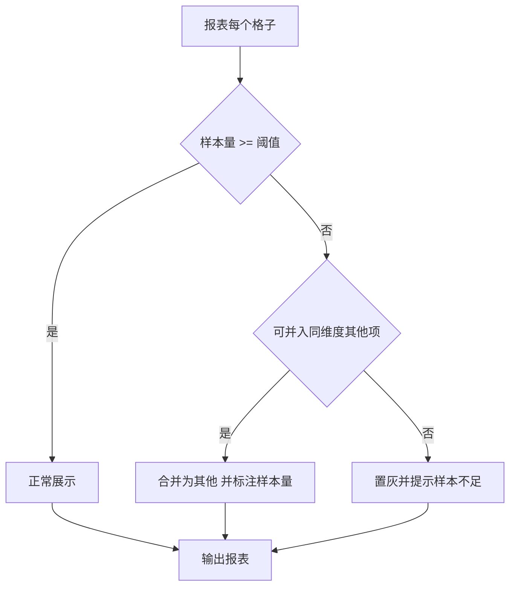

### Q1722 · 小样本抑制与报表最小展示规则

> 难度:★★☆ | 标签:报表设计, 统计口径

**问**:报表里某渠道只有 18 个访问却显示 11% 转化率,你会怎么处理这类小样本格子?

**答**:小样本格子的指标天然大起大落,18 个访问 2 单今天可以是 11%,明天变成 5%,拿这种数字做决策等于掷骰子。报表要有最小展示规则:样本量低于阈值的格子不单独展示,合并到"其他"桶并标出样本量,或者置灰提示样本不足,实测里两个小样本渠道合并后 58 个访问 12.1%。阈值按指标方差和决策成本定,转化率类 100 起步,不同指标阈值不同,写进口径文档。配套纪律:"其他"桶本身也要展示样本量,防止有人把小样本都塞进去刷出好看的数字;对外报表比内部看板更保守。

```python
# file: code/05_数据分析与工程化/q1722_small_sample.py
"""小样本抑制:格子样本量低于阈值不单独展示,合并到其他项并标注"""

CONVERSION = {
    # 渠道: (访问数, 下单数)
    "自然流量": (5200, 416),
    "信息流A": (3100, 217),
    "信息流B": (2900, 232),
    "搜索品牌": (1800, 162),
    "异业合作": (40, 5),
    "线下地推": (18, 2),
}
MIN_N = 100


def report(rows, min_n):
    big = {k: v for k, v in rows.items() if v[0] >= min_n}
    small = {k: v for k, v in rows.items() if v[0] < min_n}
    merged_n = sum(v[0] for v in small.values())
    merged_c = sum(v[1] for v in small.values())
    lines = []
    for k, (n, c) in sorted(big.items(), key=lambda x: -x[1][0]):
        lines.append(f"  {k:<8} 访问 {n:>5} 转化率 {c / n:.1%}")
    if small:
        lines.append(f"  其他(含 {len(small)} 个小样本渠道) 访问 {merged_n} 转化率 {merged_c / merged_n:.1%}")
    return lines, small


if __name__ == "__main__":
    lines, small = report(CONVERSION, MIN_N)
    print("渠道转化报表:")
    print("\n".join(lines))
    print(f"被抑制渠道: {sorted(small)} (访问数 < {MIN_N})")
    print("要点:小样本转化率天然大起大落,低于阈值要么合并要么置灰;阈值写进口径文档,'其他'桶的样本量也要展示")
```



**追问**:
- 追问 1:阈值定多少合理?—— 按指标方差和决策成本定,转化率类经验 100 到 300,可用 bootstrap 估小样本下指标波动再拍板。
- 追问 2:能不能展示小样本但加误差范围?—— 可以,点估计加置信区间比直接隐藏信息量大,但解读成本高,一般只给内部看板用。
