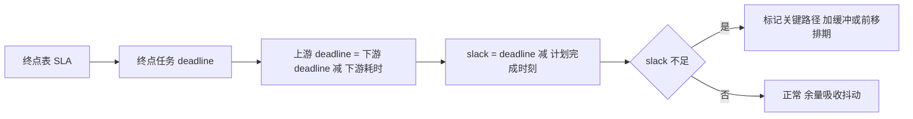

### Q1728 · 数据新鲜度 SLA 预算传导

> 难度:★★★★ | 标签:SLA, 调度

**问**:报表 SLA 是 8 点前出数,你怎么把这个 SLA 拆到链路上每个任务?上游延迟怎么传导?

**答**:终点表的 SLA 要拆成逐任务的新鲜度预算:从 SLA 反推,终点任务 deadline 就是 SLA,上游任务 deadline 等于下游 deadline 减下游计划耗时;再用计划完成时刻减 deadline 得到各任务余量,余量最小的链就是关键路径。实测里正常计划全链有余量,把 dwd_clean 耗时膨胀到 60 分钟后,故障沿链传导,三个任务同时破线,这就是"上游延迟一分钟,下游余量同步被吃掉"的直观演示。工程用途:排期时在关键路径预留缓冲,余量吃紧的任务优先告警,扩容决策看关键路径而不是总耗时。这个模型本质是关键路径法,数据管道和项目排期通用。

```python
# file: code/05_数据分析与工程化/q1728_freshness_budget.py
"""数据新鲜度 SLA 预算:终点 SLA 反推各任务 deadline,算关键路径与余量"""

TASKS = {
    # 任务: (计划开始分钟(自 0 点), 计划耗时分钟, 下游任务)
    "ods_sync": (0, 40, ["dwd_clean", "dwd_pay"]),
    "dwd_clean": (40, 35, ["dws_user"]),
    "dwd_pay": (40, 30, ["dws_user"]),
    "dws_user": (80, 45, ["ads_board"]),
    "ads_board": (120, 25, []),
}
SLA_MIN = 160  # ads_board 必须在 0 点后 160 分钟内就绪


def simulate(tasks, sla, overrides=None):
    """正推实际完成时间 + 反推 deadline,输出各任务余量"""
    overrides = overrides or {}
    preds = {t: [] for t in tasks}
    for t, (_, _, ds) in tasks.items():
        for d in ds:
            preds[d].append(t)
    order, done = [], set()
    while len(order) < len(tasks):
        prog = [t for t in tasks if t not in done and all(p in done for p in preds[t])]
        if not prog:
            raise ValueError("依赖成环")
        order.extend(prog)
        done.update(prog)
    finish = {}
    for t in order:
        start, dur, _ = tasks[t]
        earliest = max([finish[p] for p in preds[t]] + [start])
        finish[t] = earliest + overrides.get(t, dur)
    deadline = {t: (sla if not tasks[t][2] else None) for t in tasks}
    changed = True
    while changed:
        changed = False
        for t, (_, _, ds) in tasks.items():
            if deadline[t] is None and all(deadline[s] is not None for s in ds):
                deadline[t] = min(deadline[s] - tasks[s][1] for s in ds)  # 下游 deadline 扣其耗时
                changed = True
    return [(t, finish[t], deadline[t], deadline[t] - finish[t]) for t in order]


def report(rows, title):
    print(title)
    breach = False
    for t, fin, ddl, slack in rows:
        flag = " <- 破线" if slack < 0 else (" <- 关键路径,余量吃紧" if slack <= 10 else "")
        breach |= slack < 0
        print(f"  {t:<10} 预计完成 {fin:>3} 分, deadline {ddl:>3} 分, 余量 {slack:>3} 分{flag}")
    return breach


if __name__ == "__main__":
    breach = report(simulate(TASKS, SLA_MIN), "正常计划:")
    print(f"正常计划{'会' if breach else '不会'}破 SLA")
    breach2 = report(simulate(TASKS, SLA_MIN, {"dwd_clean": 60}), "故障演练:dwd_clean 膨胀到 60 分钟:")
    print(f"故障场景{'会' if breach2 else '不会'}破 SLA,需提前扩容或压缩下游")
    print("要点:新鲜度 SLA 要拆成逐任务预算,余量集中在关键路径;上游每延迟一分钟,下游余量同步被吃掉")
```



**追问**:
- 追问 1:缓冲加在哪里?—— 加在关键路径余量最小的任务前,通常前置为上游关键任务的超时配置,不平摊。
- 追问 2:SLA 违约怎么复盘?—— 记录每个任务的实际完成与预算偏差,超阈值任务进容量评审,连续超期调整排期。
