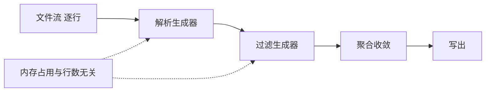

### Q1733 · 生成器流水线:恒定内存的批处理

> 难度:★★☆ | 标签:生成器, 内存优化

**问**:不用 pandas,怎么用标准库处理一个 100GB 的文本聚合?说说生成器流水线的思路。

**答**:把读、解析、过滤、聚合串成生成器流水线:每段 yield 逐条吐出,数据像水流过管道,不落地任何中间集合,内存占用只和分组数有关,和输入行数无关,百 GB 文件也跑得动。实现要点:每段是独立生成器,可以单独测试和复用;有状态的段(聚合)放最后收敛;错误处理放在解析段,坏行进隔离区而不是中断整条流。相比一次性读全量的写法,这种结构天然支持断点续跑(记住消费位置)和多进程分段并行。它是标准库处理大数据的基本功,也是理解 pandas chunksize、Spark 流水线执行的共同抽象。

```python
# file: code/05_数据分析与工程化/q1733_generator_pipeline.py
"""生成器流水线:读-解析-过滤-聚合全链路惰性求值,内存与输入规模无关"""

from io import StringIO

RAW = StringIO("city,amount\n华东,120\n华南,80\n华东,60\n华北,90\n华东,300\n华南,20\n")


def read_lines(fh):
    """跳过表头后逐行吐出"""
    for i, line in enumerate(fh):
        if i == 0:
            continue
        yield line.rstrip("\n")


def parse(rows):
    for line in rows:
        city, amount = line.split(",")
        yield city, int(amount)


def filter_big(rows, threshold=50):
    for city, amount in rows:
        if amount >= threshold:
            yield city, amount


def sum_by_city(rows):
    acc = {}
    for city, amount in rows:
        acc[city] = acc.get(city, 0) + amount
    return acc


if __name__ == "__main__":
    pipeline = filter_big(parse(read_lines(RAW)), 50)
    result = sum_by_city(pipeline)
    print("过滤后按城市求和:", dict(sorted(result.items())))
    print("要点:各段用 yield 串联,数据逐条流过不落地中间集合,到聚合器才收敛;内存 O(分组数) 而不是 O(行数),百 GB 文件也跑得动")
```



**追问**:
- 追问 1:某一段想并行怎么办?—— 用 islice 分片给多个消费者,聚合端合并结果,顺序敏感的段不能并行。
- 追问 2:怎么验证内存真的恒定?—— 用 tracemalloc 对比 1 万行和 100 万行的峰值内存,几乎不变即是证据。
