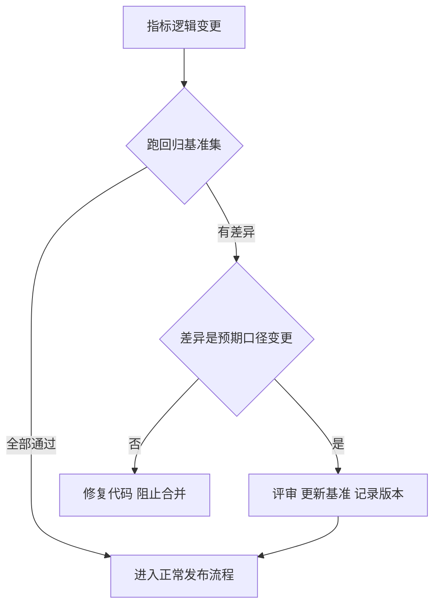

### Q1739 · 回归基准集

> 难度:★★★☆ | 标签:回归测试, 数据质量

**问**:指标计算逻辑每次改动都靠人肉点检,怎么建一套回归基准集把它钉住?

**答**:回归基准集是"固定输入加期望输出加容忍度"的用例集合,专门钉住指标计算逻辑:每次改动跑一遍,全过才放行。和单元测试的区别是它面向口径而不是代码分支,用例直接来自业务边界(空输入、退款、凑整),期望值由人确认过,实测里口径 v1 四个用例全过,改成退款不计单的 v2 后 c3 用例失败,预期内就走更新基准流程,预期外就修代码。基准更新必须走评审留版本,不允许悄悄重置,否则回归测试退化成"给当前行为拍快照"。落地是基准文件进仓库,runner 进 CI 门禁,失败输出实际与期望的差异明细。

```python
# file: code/05_数据分析与工程化/q1739_regression_bench.py
"""回归基准集:固定输入 + 期望输出 + 容忍度,指标逻辑改动先跑基准再上线"""

BENCH = [
    # case_id, 输入(订单额列表), 期望 gmv, 期望订单数
    ("c1_smoke", [100, 200, 300], 600, 3),
    ("c2_zero", [], 0, 0),
    ("c3_refund", [100, -50, 80], 130, 3),
    ("c4_round", [33, 33, 34], 100, 3),
]
TOL = 0.0


def calc_v1(orders):
    """被测口径 v1:GMV 按净额(退款冲减),订单数全量计数"""
    return sum(orders), len(orders)


def calc_v2(orders):
    """被测口径 v2:退款单不计 GMV 也不计订单数 —— 演示口径变更触发基准更新"""
    return sum(x for x in orders if x > 0), len([x for x in orders if x > 0])


def run(bench, calc, tol=TOL):
    passed, failed = 0, []
    for cid, orders, exp_gmv, exp_cnt in bench:
        gmv, cnt = calc(orders)
        if abs(gmv - exp_gmv) <= tol and cnt == exp_cnt:
            passed += 1
        else:
            failed.append((cid, (gmv, cnt), (exp_gmv, exp_cnt)))
    return passed, failed


if __name__ == "__main__":
    passed, failed = run(BENCH, calc_v1)
    print(f"口径 v1 基准回归: {passed}/{len(BENCH)} 通过")
    passed2, failed2 = run(BENCH, calc_v2)
    print(f"口径 v2 基准回归: {passed2}/{len(BENCH)} 通过")
    for cid, got, exp in failed2:
        print(f"  失败 {cid}: 实际 {got} 期望 {exp} -> 属预期口径变更则走'评审-更新基准-记版本',否则修复代码")
    print("要点:基准集=输入+期望+容忍度,进 CI 门禁;更新基准必须留版本与评审记录,不允许悄悄重置")
```



**追问**:
- 追问 1:基准集会变成复制粘贴吗?—— 会,所以期望值必须来自已确认的口径文档并带版本,用例覆盖边界而不是复制线上结果。
- 追问 2:容忍度怎么定?—— 浮点按精度定相对容忍,计数类必须精确,口径有舍入规则时按规则定。
