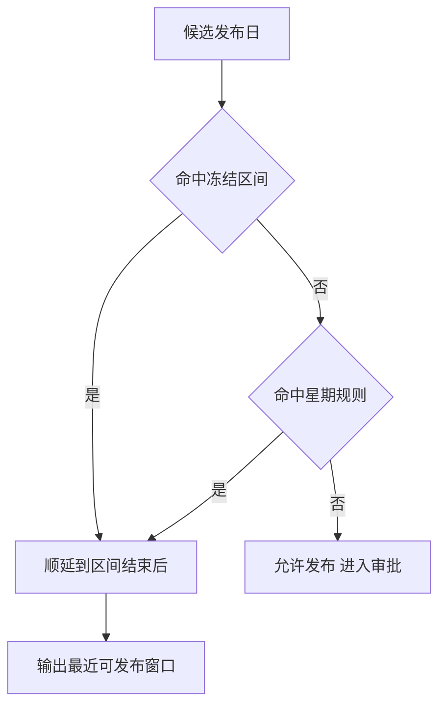

### Q1744 · 冻结日历与最近可发布窗口

> 难度:★★★★ | 标签:发布管理, 冻结期

**问**:大促、财结、周五都要冻结发布,冻结规则怎么建模?"什么时候能发"怎么回答?

**答**:冻结规则三类:日期区间(大促、财结封账)、星期规则(周五变更窗口禁用)、临时事件(线上事故后加冻),可发布判定就是三类规则的并集,实测里大促中的周五、封账中的月末都被拦下。比"能不能发"更有价值的是"什么时候能发":从候选日向后扫描,输出最近可发布窗口和等待天数,实测给出大促结束后 6 天、封账结束后 5 天的具体日期。工程上冻结日历做成服务,审批系统发布前强制校验;大促冻结覆盖放量前 3 天和收尾 2 天,临时冻结秒级生效并通知在途发布;冻结期豁免走升级审批并留记录。

```python
# file: code/05_数据分析与工程化/q1744_freeze_calendar.py
"""冻结日历:日期区间 + 星期规则求并集判定可否发布,并给最近可发布窗口"""

from datetime import date, timedelta

FREEZE_RANGES = [
    (date(2025, 11, 1), date(2025, 11, 12), "双11大促"),
    (date(2025, 12, 28), date(2026, 1, 3), "财结封账"),
]
WEEKLY_FROZEN = {4: "周五变更窗口禁用"}  # Monday=0


def is_frozen(d):
    for start, end, reason in FREEZE_RANGES:
        if start <= d <= end:
            return True, reason
    if d.weekday() in WEEKLY_FROZEN:
        return True, WEEKLY_FROZEN[d.weekday()]
    return False, None


def next_release(d, horizon=45):
    for i in range(horizon):
        cand = d + timedelta(days=i)
        if not is_frozen(cand)[0]:
            return cand, i
    return None, horizon


if __name__ == "__main__":
    for d in (date(2025, 10, 28), date(2025, 11, 7), date(2025, 12, 30)):
        frozen, reason = is_frozen(d)
        if frozen:
            cand, wait = next_release(d)
            print(f"{d} 冻结中({reason}),最近可发布 {cand},等待 {wait} 天")
        else:
            print(f"{d} 可发布")
    print("要点:冻结规则=区间+星期+临时事件的并集,审批系统强制校验;大促冻结要覆盖放量前 3 天和收尾 2 天,临时冻结要能秒级加进去")
```



**追问**:
- 追问 1:临时冻结怎么快速生效?—— 冻结日历服务热更新,生效即广播通知在途发布,审批队列自动重校验。
- 追问 2:冻结期出了 P0 故障怎么办?—— 修复类变更走紧急豁免通道,双人审批加事后复盘,豁免记录单独审计。
