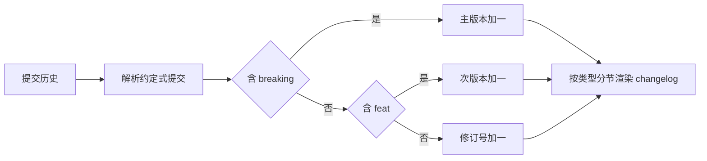

### Q1750 · changelog 自动生成

> 难度:★★☆ | 标签:提交规范, 版本管理

**问**:发版说明每次手写又漏又乱,怎么从提交记录自动生成 changelog?

**答**:约定式提交的红利就是 changelog 可以机器生成:解析 type 加 scope 加感叹号加描述,按 feat、fix、docs、chore 分节渲染,带感叹号的提交进 BREAKING 区并要求附迁移说明;版本号由提交类型推导,有 breaking 升主版本,有 feat 升次版本,否则升修订号,完全不用人拍脑袋,实测里一次含 breaking 的提交把 1.4.2 推到 2.0.0。配套是 commit lint 进 CI,不合规提交直接拒,范围漏写、描述空泛同样拦;changelog 生成后进发布说明,和 git tag 原子对应存档。这套机制的真正价值是让"改了什么"有唯一事实源,事故追溯和客户通知都从这里出发。

```python
# file: code/05_数据分析与工程化/q1750_changelog.py
"""changelog 自动生成:解析约定式提交,按类型分节,顺手算下一个版本号"""

import re

COMMITS = [
    "feat(board): 新增留存看板",
    "fix(etl): 修复时区偏移导致的重复计数",
    "feat(api)!: 调整分页参数为 cursor",     # ! 表示 breaking
    "chore(deps): 升级 pandas",
    "docs(readme): 补充部署说明",
]
PAT = re.compile(r"^(\w+)(?:\(([^)]*)\))?(!)?: (.+)$")


def parse(msg):
    m = PAT.match(msg)
    if not m:
        return None
    return {"type": m.group(1), "scope": m.group(2),
            "breaking": bool(m.group(3)), "subject": m.group(4)}


def bump(version, commits):
    parsed = [p for p in (parse(c) for c in commits) if p]
    major, minor, patch = map(int, version.split("."))
    if any(p["breaking"] for p in parsed):
        return f"{major + 1}.0.0"
    if "feat" in {p["type"] for p in parsed}:
        return f"{major}.{minor + 1}.0"
    return f"{major}.{minor}.{patch + 1}"


def changelog(version, commits):
    parsed = [p for p in (parse(c) for c in commits) if p]
    sections = {"feat": "### 新功能", "fix": "### 修复", "chore": "### 杂项", "docs": "### 文档"}
    out = [f"## {version}", ""]
    if any(p["breaking"] for p in parsed):
        out += ["**BREAKING**: 存在不兼容变更,升级前阅读迁移说明", ""]
    for t, title in sections.items():
        items = [p for p in parsed if p["type"] == t]
        if items:
            out.append(title)
            out += [f"- {p['scope'] + ': ' if p['scope'] else ''}{p['subject']}" for p in items]
            out.append("")
    return "\n".join(out)


if __name__ == "__main__":
    nxt = bump("1.4.2", COMMITS)
    print(changelog(nxt, COMMITS))
    print(f"下一版本: 1.4.2 -> {nxt}")
    print("要点:changelog 是提交规范的红利,feat/fix/! 约定进 commit lint;breaking 必须附迁移说明,版本号由提交类型推导而不是拍脑袋")
```



**追问**:
- 追问 1:merge commit 怎么处理?—— 跳过 merge commit 只看分支原始提交,或依赖 squash 合并时的 PR 标题规范。
- 追问 2:changelog 和 git tag 怎么对应?—— 发布时生成 changelog 连同版本号写入 tag 注释对象,两者原子提交。
