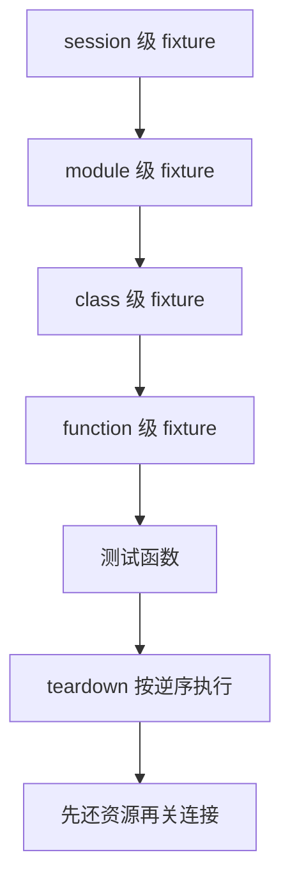

### Q189 · yield fixture 与清理顺序

> 难度:★★☆ | 标签:pytest, fixture, teardown

**问**:fixture 怎么做清理?多个 fixture 的 teardown 顺序是什么?

**答**:用 `yield` 写法:yield 之前是 setup,yield 之后是 teardown,即使测试失败也会执行。teardown 顺序与 setup **严格相反**(栈式):C 依赖 B、B 依赖 A,则先 setup A→B→C,测试后先 teardown C→B→A。这保证了资源以创建的逆序释放(先关事务、再还连接、最后关池)。另外 `addfinalizer` 注册的回调同样在栈上,且可以在 fixture 中途注册;yield 写法更直观,推荐优先使用。

```python
# file: code/05_数据分析与工程化/q189_yield_fixture.py
try:
    import pytest
except ImportError:
    print("该题演示需要第三方库 pytest:pip install pytest(正文已讲清原理,安装后可运行)")
    raise SystemExit(0)

steps = []

@pytest.fixture
def a():
    steps.append("setup a")
    yield "a"
    steps.append("teardown a")

@pytest.fixture
def b(a):
    steps.append("setup b")
    yield f"b on {a}"
    steps.append("teardown b")

@pytest.fixture
def c(b):
    steps.append("setup c")
    yield f"c on {b}"
    steps.append("teardown c")

def test_order(c):
    # setup: a, b, c
    assert c == "c on b on a"

def test_teardown_order():
    # 上一个测试结束后,清理顺序是 c, b, a
    assert steps == ["setup a", "setup b", "setup c",
                     "teardown c", "teardown b", "teardown a"]
```

**追问**:
- yield fixture 的清理在 Ctrl-C 中断时执行吗?——pytest 会尽量执行已注册的 finalizer;被 SIGKILL 硬杀时不会,关键外部资源要有兜底回收(超时/对账)。
- addfinalizer 和 yield 写法怎么选?——yield 更直观;需要「创建过程中途注册清理」或多个清理回调时用 addfinalizer。
- 为什么 teardown 顺序是逆序?——资源有依赖链(事务在连接上,连接在池里),只有逆序才能安全释放;栈式结构天然保证。


