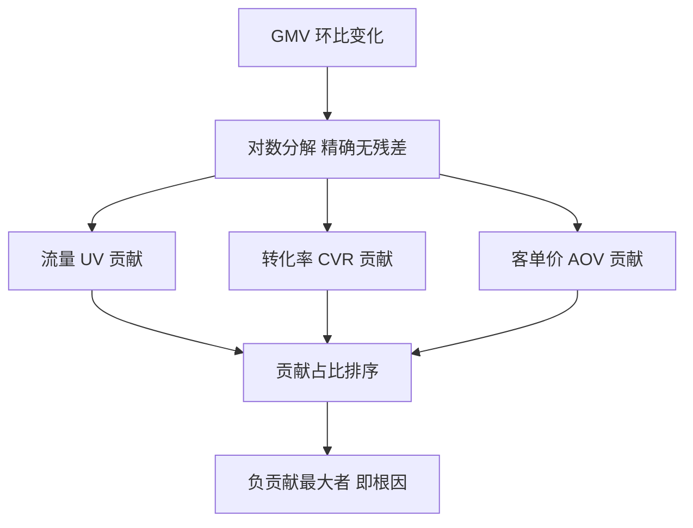

### Q1979 · 指标树拆解:乘法链与对数贡献分解

> 难度:★★★★★ | 标签:指标拆解, 归因

**问**:GMV 涨了或者跌了,你怎么把原因讲清楚,而不是说"流量不行"?

**答**:把 KPI 拆成乘法链:GMV=UV×转化率×客单价,指标树建在口径字典里,每个叶子有唯一负责人。环比差异用对数分解:log(GMV1/GMV0) 精确等于各因子 log 比值之和,零残差,各因子贡献占比一目了然。实测 GMV +3.52%,UV -6.7% 贡献 -201%、转化率 +7.4% 贡献 +206%、客单价 +3.4% 贡献 +96%——流量下滑被转化率提升几乎完全对冲,这就是分解的价值。注意总变化接近 0 时占比会爆成几百个百分点,那时只报方向不报占比。维度下钻回答"哪个渠道哪个地区",指标树回答"哪个因子",两者结合才是完整归因。

```python
# file: code/05_数据分析与工程化/q1979_metric_tree.py
"""指标树拆解:GMV = UV x 转化率 x 客单价,对数分解精确定位因子贡献"""

import math

BASE = {"uv": 52000, "cvr": 0.0420, "aov": 142.8}
CURR = {"uv": 48500, "cvr": 0.0451, "aov": 147.6}
FACTORS = [("uv", "流量UV"), ("cvr", "转化率"), ("aov", "客单价")]


def gmv(f):
    return f["uv"] * f["cvr"] * f["aov"]


def log_decompose(base, curr):
    """log(GMV1/GMV0) = sum log(因子比值),各因子贡献之和恒等于总变化"""
    total = math.log(gmv(curr) / gmv(base))
    parts = {k: math.log(curr[k] / base[k]) for k in base}
    return total, parts


if __name__ == "__main__":
    g0, g1 = gmv(BASE), gmv(CURR)
    print(f"GMV: {g0:,.0f} -> {g1:,.0f}  变化 {g1 / g0 - 1:+.2%}")
    total, parts = log_decompose(BASE, CURR)
    residue = total - sum(parts.values())
    print(f"总对数变化 {total:+.4f},残差 {residue:.2e}(对数分解精确无残差)")
    for k, name in FACTORS:
        delta = CURR[k] / BASE[k] - 1
        share = parts[k] / total if abs(total) > 1e-12 else 0.0
        print(f"  {name:<6} {BASE[k]:>8} -> {CURR[k]:>8} ({delta:+.1%})  贡献 {share:+.0%}")
    print("要点:乘法链指标用对数分解替代拍脑袋归因;总变化接近 0 时占比无意义只报方向;维度下钻答'谁',指标树答'为什么'")
```



**追问**:
- 追问 1:因子间强相关怎么办?—— 对数分解是恒等式不依赖独立性,但解释时别说因果,要下因子级实验或时序对照。
- 追问 2:指标树和杜邦分析什么关系?—— 同一思想,财务的 ROE 三拆就是指标树,数据团队把它推广到任意乘法链 KPI。
