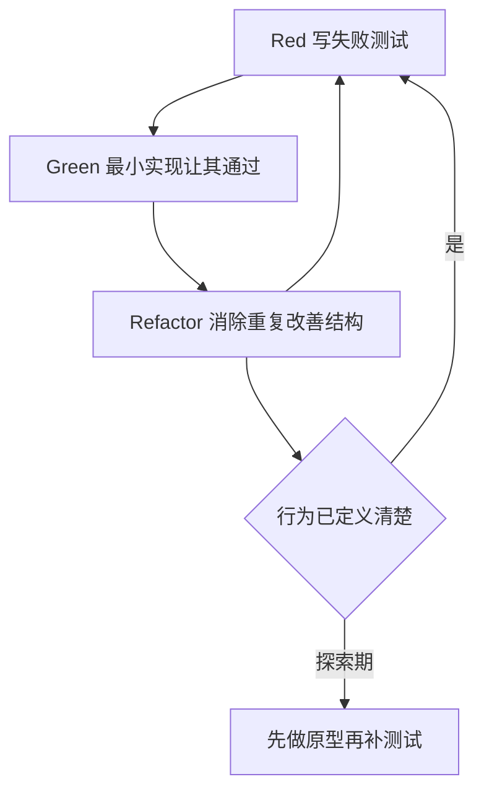
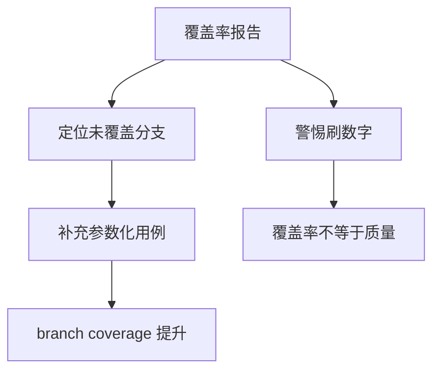

### Q198 · TDD 的价值与取舍

> 难度:★★☆ | 标签:TDD, red-green-refactor

**问**:你实际用 TDD 吗?什么场景下 TDD 反而是负担?

**答**:TDD 循环是 **red → green → refactor**:先写一个失败的测试定义行为,再用最小实现让它通过,最后重构。它的真实价值不是"测试多",而是**设计驱动**——先写测试迫使你想清楚接口、依赖边界和错误处理;回归保护是副产品。适合:逻辑清晰、契约稳定的算法/领域逻辑/修 bug(先复现再修复)。不适合:探索性原型、UI 布局、频繁变动的接口——需求本身在漂移时,先写测试等于把猜想焊死,重构成本翻倍。务实的说法:核心逻辑 TDD,胶水代码后补测试,比教条地"全程 TDD"更可持续。

```python
# file: code/05_数据分析与工程化/q198_tdd_demo.py
# Red:先写失败测试,定义期望行为
def test_split_name():
    from q198_tdd_demo import split_full_name  # noqa
    first, last = split_full_name("Ada Lovelace")
    assert first == "Ada"
    assert last == "Lovelace"

def test_split_name_single():
    from q198_tdd_demo import split_full_name
    # Green 阶段补的边界:只有一个词时 last 为空
    first, last = split_full_name("Cher")
    assert first == "Cher"
    assert last == ""

def split_full_name(full):
    # Refactor 后的实现:最小实现通过全部测试
    parts = full.split()
    if not parts:
        return "", ""
    return parts[0], " ".join(parts[1:])
```

**追问**:
- 修 bug 时的 TDD 流程?——先写一个复现 bug 的失败测试(红)→ 修复(绿)→ 回归确认;这个测试永久保留防复发。
- TDD 和重构的关系?——有测试才有安全网,重构才能放开手;没有测试的重构是赌博。
- 遗留代码怎么开始补测试?——characterization test(刻画现有行为,哪怕行为是错的)锁住现状,再小步重构。




