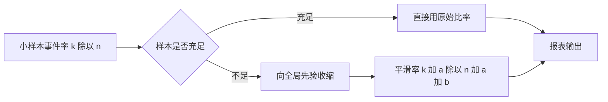

### Q1981 · 稀疏事件平滑:伪计数与贝叶斯收缩

> 难度:★★★★ | 标签:平滑, 小样本

**问**:按页面统计支付失败率,小页面一会儿 0% 一会儿 50%,排名完全没法看,怎么办?

**答**:低频事件率在小样本分组上剧烈跳动,实测 2/4 的页面原始率 50%,样本 900 的页面只有 1.2%,直接排序毫无意义。平滑的思想是给每个分组注入先验:平滑率等于 (k+a)/(n+a+b),a、b 来自全体数据拟合的 Beta 先验(矩估计),样本越小组越被拉向全局均值,大组几乎不动。实测 0/6 的页面从 0% 收缩到 2.1%,2/4 从 50% 收缩到 19.2%。拉普拉斯加一是特例,先验是均匀分布,不如数据驱动先验准。样本上万就不需要平滑;平滑后的数字必须在报表标注方法,不能和原始率混排,否则读者不知道自己在看什么口径。

```python
# file: code/05_数据分析与工程化/q1981_sparse_smooth.py
"""稀疏事件平滑:伪计数与贝叶斯收缩,小样本率向全局均值收缩防跳变"""

EVENTS = {"页面A": (3, 40), "页面B": (28, 320), "页面C": (0, 6),
          "页面D": (5, 50), "页面E": (11, 900), "页面F": (2, 4)}


def fit_prior(pairs):
    """矩估计 Beta 先验:均值取全体比率,离散度人工给定并夹底防负"""
    n_total = sum(n for _, n in pairs)
    k_total = sum(k for k, _ in pairs)
    mean = k_total / n_total
    var = max(0.004, 1e-6)
    common = max(mean * (1 - mean) / var - 1, 1.0)
    return mean * common, (1 - mean) * common


def shrink(k, n, a, b):
    """平滑率 = (k + a) / (n + a + b),n 越小越贴近先验均值"""
    return (k + a) / (n + a + b)


if __name__ == "__main__":
    a, b = fit_prior(list(EVENTS.values()))
    print(f"Beta 先验: a={a:.3f} b={b:.3f},先验均值 {a / (a + b):.3f}")
    print(f"{'页面':<6}{'原始比率':>10}{'拉普拉斯':>10}{'贝叶斯收缩':>11}")
    for name, (k, n) in sorted(EVENTS.items()):
        raw = k / n if n else 0.0
        lap = (k + 1) / (n + 2)
        sm = shrink(k, n, a, b)
        print(f"{name:<6}{raw:>10.1%}{lap:>10.1%}{sm:>11.1%}")
    print("要点:小样本页面的原始率会在 0% 和 50% 之间乱跳;拉普拉斯是均匀先验,贝叶斯收缩向真实全局均值收;样本越大收缩越弱,两万级样本无需平滑")
```



**追问**:
- 追问 1:先验方差怎么定?—— 用历史多期数据的组间方差做矩估计并定期重估,方差越小收缩越强。
- 追问 2:平滑和最小展示阈值怎么选?—— 阈值简单粗暴会把长尾全藏掉,平滑保留全部分组但承认不确定性,排名类场景平滑更合适。
