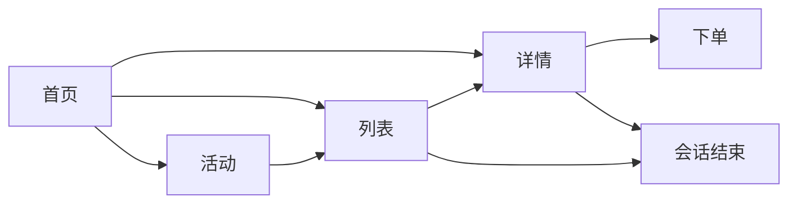

### Q1986 · 跳转矩阵:页面间转移概率与主流出

> 难度:★★★☆ | 标签:路径分析, 转移矩阵

**问**:想看用户在页面之间实际怎么跳,怎么把会话日志变成可分析的结构?

**答**:把每条会话按相邻页面切成转移对,计数后按行归一,得到一步转移概率矩阵:行是"从哪来",列是"到哪去",终点页一行全零。从矩阵里读三件事:每页最大去向(用户认为的自然路径)、每个转移的概率(路径是否集中)、流出率(会话在该页结束的比例)。实测详情页最大去向是下单 100%,但活动页一半会话直接结束——活动页才是断点。跳转矩阵是路径分析的骨架,Top-N 路径、漏斗设计、流失页定位都从它出发。注意它只记相邻两步,跨步路径要靠 n 阶矩阵或序列分析;页面集合要先归一化,带参数的 URL 会把矩阵撑爆。

```python
# file: code/05_数据分析与工程化/q1986_transition_matrix.py
"""跳转矩阵:页面序列转转移概率,找主流出页"""

SESSIONS = [
    ["首页", "列表", "详情", "下单"],
    ["首页", "列表", "详情"],
    ["首页", "详情", "下单"],
    ["首页", "列表"],
    ["首页", "活动", "列表", "详情", "下单"],
    ["首页", "活动"],
    ["首页", "列表", "详情"],
    ["首页", "详情"],
]


def transitions(sessions):
    cnt = {}
    for path in sessions:
        for a, b in zip(path, path[1:]):
            cnt[(a, b)] = cnt.get((a, b), 0) + 1
    return cnt


def row_normalize(cnt):
    totals = {}
    for (a, b), c in cnt.items():
        totals[a] = totals.get(a, 0) + c
    probs = {(a, b): c / totals[a] for (a, b), c in cnt.items()}
    return probs, totals


if __name__ == "__main__":
    cnt = transitions(SESSIONS)
    probs, totals = row_normalize(cnt)
    pages = sorted({p for path in SESSIONS for p in path})
    print("转移概率(行归一):")
    print("    " + "".join(f"{p:>6}" for p in pages))
    for a in pages:
        row = "".join(f"{probs.get((a, b), 0):>6.2f}" for b in pages)
        print(f"{a:<4}" + row)
    arrive = {}
    for path in SESSIONS:
        for p in path:
            arrive[p] = arrive.get(p, 0) + 1
    print("各页去向与流出:")
    for a in pages:
        outgoing = [(p, b) for (x, b), p in probs.items() if x == a]
        ends = sum(1 for path in SESSIONS if path[-1] == a)
        if not outgoing:
            print(f"  {a}: 终点页,到达 {arrive[a]} 次,全部会话在此结束")
            continue
        best = max(outgoing)
        print(f"  {a}: 到达 {arrive[a]} 次,最大去向 {best[1]} {best[0]:.0%},"
              f"会话在此结束 {ends / arrive[a]:.0%}")
    print("要点:转移矩阵按行归一,每行是一步的条件分布;流出率高的页是漏斗断点,优先修'最大去向占比低且流出率高'的页")
```



**追问**:
- 追问 1:转移矩阵和漏斗什么关系?—— 漏斗是给定顺序的强约束,矩阵是无约束的全量转移,漏斗设计前先看用户实际怎么走。
- 追问 2:稀疏页面怎么处理?—— 长尾页面聚合成"其他"桶,矩阵维度控制在两位数以内再分析。
