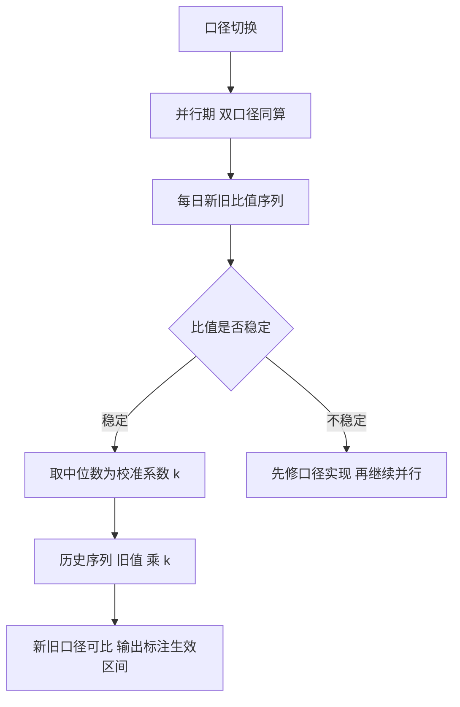

### Q1990 · 口径变更桥接:新旧口径并行期的差异桥

> 难度:★★★★ | 标签:口径变更, 桥接分析

**问**:活跃口径必须从"任意事件"改成"关键事件",新口径天然比旧口径低一截,你怎么保证长期曲线不断?

**答**:口径切换最大的风险是历史序列断裂:曲线陡降被误读成业务崩盘。桥接的标准做法是并行期换算:切换前至少两周新旧口径每天同时算,得到新/旧比值序列;比值稳定则取中位数为校准系数,实测七天内极差只有 0.0069,取 k=0.8919;历史序列乘 k 换算到新口径,并校验换算值与并行期实测吻合(12180×k=10863,约等于新口径实测 10900)。比值不稳定说明口径实现本身有波动,先修实现再并行,不能硬接。输出必须标注:哪些区间是实测新口径、哪些是换算、系数与生效日期;口径字典永久保留旧口径定义,审计回溯都靠它。

```python
# file: code/05_数据分析与工程化/q1990_metric_bridge.py
"""口径变更桥接:并行期双口径算校准系数,历史数据按系数换算可比"""

PARALLEL = [
    # (日期, 旧口径日活, 新口径日活)
    ("11-01", 10200, 9100), ("11-02", 10450, 9320), ("11-03", 10180, 9050),
    ("11-04", 10990, 9800), ("11-05", 11230, 10010), ("11-06", 12300, 11020),
    ("11-07", 12180, 10900),
]


def calibration_ratio(rows):
    """并行期新/旧比值的中位数做校准系数,抗单日波动"""
    ratios = sorted(new / old for _, old, new in rows)
    n = len(ratios)
    mid = ratios[n // 2] if n % 2 else (ratios[n // 2 - 1] + ratios[n // 2]) / 2
    return mid, ratios


if __name__ == "__main__":
    k, ratios = calibration_ratio(PARALLEL)
    print("并行期 新/旧 比值:", [f"{r:.4f}" for r in ratios])
    print(f"校准系数(中位数)k = {k:.4f}")
    old_last = PARALLEL[-1][1]   # 并行期最后一天的旧口径实测
    print(f"桥接校验: 同日旧口径 {old_last} x k = {old_last * k:.0f}"
          f"  ≈ 新口径实测 {PARALLEL[-1][2]}")
    drift = max(ratios) - min(ratios)
    verdict = "稳定,系数可用" if drift < 0.03 else "波动大,先查口径实现再并行"
    print(f"比值极差 {drift:.4f} -> {verdict}")
    print("要点:切换前至少两周并行;系数取中位数;换算序列必须标注口径与系数生效区间,报表读者有权知道今天和昨天用的不是一个定义")
```



**追问**:
- 追问 1:并行期成本太高怎么办?—— 至少覆盖一个完整周循环(七天)再加两端各一天,并避开大促期。
- 追问 2:校准系数会漂移吗?—— 会,业务结构变化会改变新旧口径差,系数要定期复检,超阈值重新并行。
