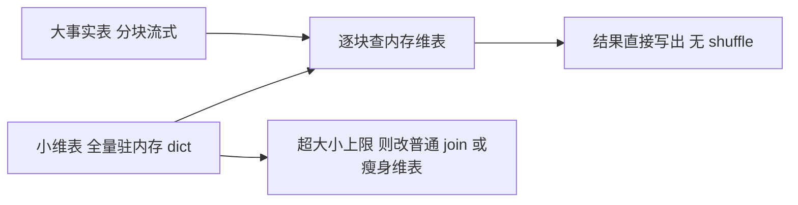

### Q1995 · 小维表广播 join:避免大表 shuffle

> 难度:★★★★ | 标签:join 优化, 数据管道

**问**:大事实表关联一张小维表,引擎为什么经常选错 join 策略?广播 join 的原理和边界是什么?

**答**:大表 join 小维表时,把维表整个装进内存 dict,大表分块流式过、逐行查表,这就是广播 join:没有 shuffle,复杂度线性于大表行数。对照朴素嵌套循环是 O(大表×维表),实测 6 行大表对 5 行维表就要扫 26 次,百万行对十万行不可行。适用边界是维表几十 MB 内;超过上限要么给维表瘦身(只留需要列或热键),要么回到 shuffle join。两个工程细节:维表要定时刷新并带版本,别拿昨天的维表 join 今天的事实;未命中键给默认值并单独计数,实测 u9 未命中被标记"未知"——join 静默丢行是最难查的数据事故之一。

```python
# file: code/05_数据分析与工程化/q1995_broadcast_join.py
"""小维表广播 join:维表进内存 dict,大表分块流式查表,无 shuffle"""

DIM_USER = {"u1": "VIP", "u2": "普通", "u3": "VIP", "u4": "普通", "u5": "普通"}

FACT_CHUNKS = [
    [("o1", "u1", 200), ("o2", "u3", 150)],
    [("o3", "u2", 88), ("o4", "u9", 66)],   # u9 不在维表
    [("o5", "u1", 320), ("o6", "u5", 99)],
]


def broadcast_join(chunks, dim, default="未知"):
    """大表按块流式过,维表常驻内存 dict,复杂度 O(大表行数),无 shuffle"""
    missed = 0
    for chunk in chunks:
        out = []
        for oid, uid, amt in chunk:
            level = dim.get(uid)
            if level is None:
                missed += 1
                level = default
            out.append((oid, uid, amt, level))
        yield out, missed


def naive_join_cost(chunks, dim):
    """对照:每行全量扫维表,O(大表 x 维表),维表大时不可行"""
    scans = 0
    for chunk in chunks:
        for row in chunk:
            for k in dim:
                scans += 1
                if k == row[1]:
                    break
    return scans


if __name__ == "__main__":
    total_miss = 0
    for chunk, missed in broadcast_join(FACT_CHUNKS, DIM_USER):
        for row in chunk:
            print("  ", row)
        total_miss = missed
    probes = sum(len(c) for c in FACT_CHUNKS)
    scans = naive_join_cost(FACT_CHUNKS, DIM_USER)
    print(f"广播查表 {probes} 次;朴素嵌套循环扫描 {scans} 次(维表 {len(DIM_USER)} 行)")
    print(f"未命中维表的行 {total_miss} 条,已用默认值标记并单独计数")
    print("要点:几十 MB 内的维表广播最优;广播表要设大小上限并定时刷新;未命中给默认值且计数,不让 join 静默丢行")
```



**追问**:
- 追问 1:维表多大算小?—— 经验值 100MB 到 1GB,取决于执行器内存,关键是能整体驻留且留有余量。
- 追问 2:Spark 里怎么确认真的广播了?—— broadcast 提示或依赖引擎自动广播,然后看物理计划里有没有 BroadcastHashJoin,别只看没报错。
