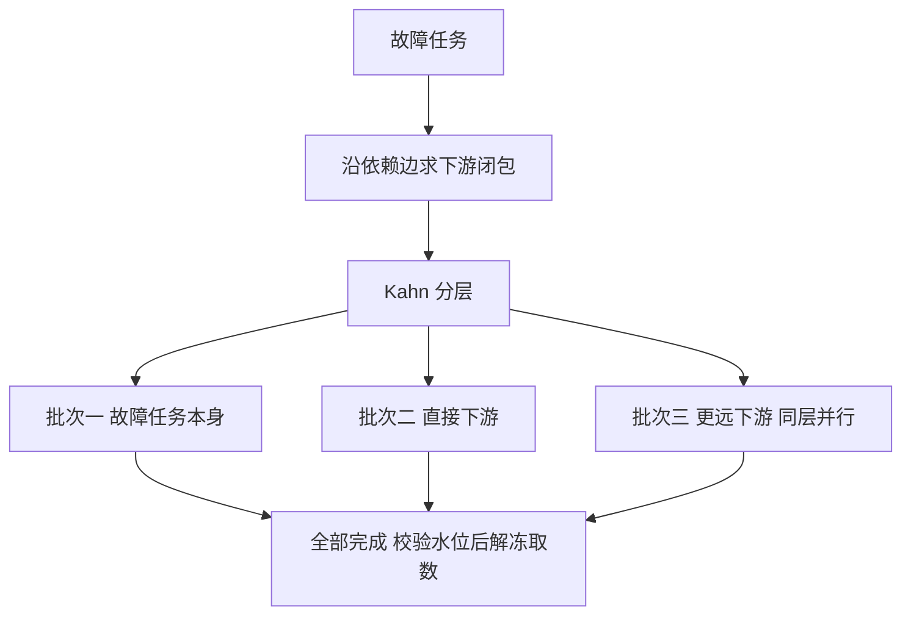

### Q1998 · 管道重放:受影响下游闭包与重放顺序

> 难度:★★★★ | 标签:重放, 依赖管理

**问**:上游任务失败重跑后,下游几十个任务怎么办?全量重跑还是挑着跑?顺序怎么定?

**答**:下游不是全部重跑,而是"受影响的下游闭包"。步骤:在依赖 DAG 上从故障任务沿边正向 BFS 求闭包,实测 ods_orders 故障,闭包 5 个任务;对闭包子图做 Kahn 拓扑分层,同层可并行、层间串行,输出批次计划,实测分 4 批。重放期间冻结下游取数,全部批次完成后校验水位与行数再解冻。三个纪律:闭包外任务不动,避免重放扩大化;同层任务可并行,但写同一张表的要串行;重放计划生成器先 dry-run 输出确认再执行——这一步把事故恢复从"老师傅经验"变成"任何人可执行"。

```python
# file: code/05_数据分析与工程化/q1998_replay_plan.py
"""故障重放:从故障任务反查下游闭包,拓扑分层给出重放批次"""

DAG = {
    "ods_orders": ["dwd_orders"],
    "ods_users": ["dwd_users"],
    "dwd_orders": ["dws_shop_day", "ads_funnel"],
    "dwd_users": ["dws_shop_day"],
    "dws_shop_day": ["ads_gmv", "ads_funnel"],
    "ads_gmv": [],
    "ads_funnel": [],
}
FAILED = ["ods_orders"]


def downstream(dag, starts):
    """沿边正向 BFS,求故障任务的受影响下游闭包(含自身)"""
    seen, stack = set(), list(starts)
    while stack:
        node = stack.pop()
        if node in seen:
            continue
        seen.add(node)
        stack.extend(dag.get(node, []))
    return seen


def topo_batches(sub_dag):
    """Kahn 分层:同层任务可并行重放"""
    indeg = {n: 0 for n in sub_dag}
    for vs in sub_dag.values():
        for v in vs:
            indeg[v] += 1
    layer = sorted(n for n, d in indeg.items() if d == 0)
    batches = []
    while layer:
        batches.append(layer)
        nxt = []
        for u in layer:
            for v in sub_dag[u]:
                indeg[v] -= 1
                if indeg[v] == 0:
                    nxt.append(v)
        layer = sorted(nxt)
    return batches


if __name__ == "__main__":
    closure = downstream(DAG, FAILED)
    sub = {n: [v for v in DAG.get(n, []) if v in closure] for n in closure}
    print(f"故障: {FAILED} -> 受影响闭包 {len(closure)} 个任务: {sorted(closure)}")
    for i, batch in enumerate(topo_batches(sub), 1):
        print(f"  重放批次{i}(可并行): {batch}")
    print("要点:先求闭包再分层,同层并行、层间串行;重放期间冻结下游取数,全部完成后校验水位与行数再解冻;闭包外任务不动,避免重放扩大化")
```



**追问**:
- 追问 1:闭包里有的任务重放后数据没变,白跑了怎么办?—— 幂等覆盖写让重复重放无害,优先保证正确性;要省算力可在重放前比对上游分区指纹。
- 追问 2:依赖是数据就绪而非任务依赖怎么办?—— 就绪检查也建模成依赖节点,重放计划里插入就绪等待步骤。
