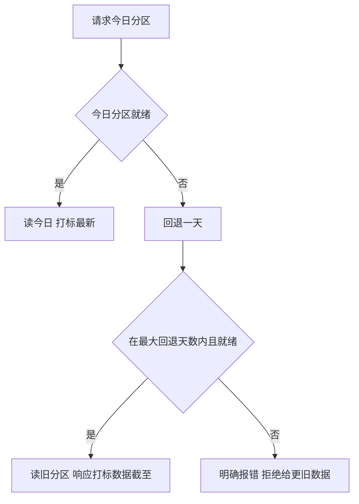

### Q2004 · 上游延迟降级读:新鲜度兜底选分区

> 难度:★★★★ | 标签:降级, 数据新鲜度

**问**:今天的数据分区迟到了,下游接口是等、报错,还是读昨天的数据?怎么把"读旧数据"做得体面?

**答**:规范做法是降级读:目标分区未就绪则按天回退,在最大回退天数(实测设 2 天)内找就绪分区,命中后响应必须打标——实测打 data_date=2026-11-03,前端展示"数据截至昨日";超出回退范围就明确报错,绝不静默给更旧的数据。三个纪律:回退天数是 SLA 的一部分,与上游新鲜度预算联动,不是代码里随手写的数字;打标信息要让下游无法忽略,响应头加字段级标注;降级事件本身要计数上报,长期频繁降级说明上游该修了。这比"一律报错"业务友好,比"永远给最新可用"诚实。注意财务对账、结算类场景禁止降级读,宁可不可用不能给错数。

```python
# file: code/05_数据分析与工程化/q2004_stale_fallback.py
"""上游延迟降级读:目标分区未就绪时回退旧分区并标注新鲜度"""

from datetime import date, timedelta

READY = {
    "2026-11-04": False,   # 今日分区上游迟到
    "2026-11-03": True,
    "2026-11-02": True,
    "2026-11-01": True,
}
ROWCOUNTS = {"2026-11-03": 122_000, "2026-11-02": 118_000, "2026-11-01": 90_000}
STALE_LIMIT = 2   # 最多回退 2 天,这是 SLA 的一部分


def choose_partition(target, ready, limit):
    d = date.fromisoformat(target)
    for back in range(limit + 1):
        cand = (d - timedelta(days=back)).isoformat()
        if ready.get(cand):
            return cand, back
    return None, limit + 1


if __name__ == "__main__":
    part, back = choose_partition("2026-11-04", READY, STALE_LIMIT)
    if part is None:
        print("降级失败:回退范围内无就绪分区,接口应报错而不是给空结果")
    else:
        tag = "最新" if back == 0 else f"降级 T-{back}"
        print(f"请求 2026-11-04 -> 实际读 {part} [{tag}],行数 {ROWCOUNTS.get(part, 0):,}")
        if back:
            print(f"响应打标 data_date={part},前端展示'数据截至 {part}'")
    print("要点:降级读必须有显式标注与最大回退天数;宁可报错也不静默给更旧的数据;回退天数与上游 SLA 联动,不是拍脑袋")
```



**追问**:
- 追问 1:什么场景禁止降级读?—— 财务对账与结算,宁可不可用不能给错数;降级只用于展示类读。
- 追问 2:分区就绪状态怎么维护?—— 上游发布完成后写就绪标记(带行数与校验和),读侧只信标记,不做猜测式探测。
