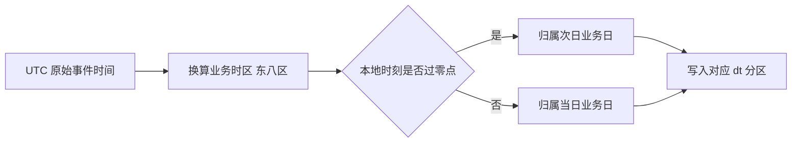

### Q2007 · 业务日切:数据分区归属与跨时区边界

> 难度:★★★★ | 标签:日切, 时区

**问**:数据分区按 UTC 日期切还是按业务日切?凌晨的订单该算哪天?这个定义错了会怎样?

**答**:分区归属不等于 UTC 日期,业务日由业务时区决定:东八区业务日按北京时间 0 点切,对应 UTC 16 点,实测 UTC 15:59 属当日、16:01 已属次日。日切错了,所有日报的分子分母都在错误的桶里,而且是系统性错一天,很难从数字本身发现。规范:业务日定义(时区加切点)写进口径字典,全公司唯一;分区写入统一走 business_day 函数,禁止各管道自己转换;跨时区业务按主市场定一套业务日,其他时区映射过去。改日切定义等于重写全部历史分区,成本极高,上线前必须评审到位。

```python
# file: code/05_数据分析与工程化/q2007_business_day.py
"""业务日切:UTC 时间戳按东八区 0 点切业务日,决定分区归属"""

from datetime import datetime, timedelta, timezone

CST = timezone(timedelta(hours=8))
CASES = [
    "2026-11-04T15:59:00+00:00",   # 北京 23:59,业务日 11-04
    "2026-11-04T16:01:00+00:00",   # 北京 00:01,业务日 11-05
    "2026-11-04T07:00:00+00:00",   # 北京 15:00,业务日 11-04
    "2026-11-04T18:30:00+00:00",   # 北京 02:30,已属次日
]


def business_day(ts_str):
    ts = datetime.fromisoformat(ts_str).astimezone(CST)
    return ts.date(), ts.strftime("%H:%M")


if __name__ == "__main__":
    for s in CASES:
        d, hm = business_day(s)
        print(f"UTC {s}  北京 {hm} -> 业务日 {d}  分区 dt={d}")
    print("要点:分区按业务日切而不是 UTC 日,日切边界由业务定并写入口径字典;改动日切定义等于重写全部分区,必须评审;跨时区业务要一司一套业务日,禁止各管道自定义")
```



**追问**:
- 追问 1:为什么不用各地当地时间各自切?—— 多时区各自切会让"同一天"口径分裂,跨区对账无法进行;统一业务日牺牲局部精确换全局可比。
- 追问 2:业务说"凌晨 6 点前算前一天"怎么办?—— 显式改切点为北京时间 6 点并做并行桥接,不要在代码里散落 if hour 判断。
