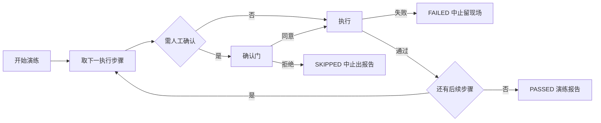

### Q2013 · 演练清单执行器:步骤状态机与人工确认门

> 难度:★★★☆ | 标签:演练, 自动化

**问**:故障演练的 runbook 写在 wiki 上没人照着执行,怎么把它变成可靠执行的流程?

**答**:执行器把剧本变成可运行的状态机:步骤列表(名称、动作、是否需人工确认),逐个执行,确认门暂停等人工应答,失败即中止,最后产出报告(passed/failed/skipped 三态加耗时)。实测四步剧本在"恢复写"步骤失败,执行器立即中止,验证步骤未执行——绝不硬跑后面的步骤,那是二次事故的来源。人工确认门是演练执行器与普通脚本的本质区别:停写、切流这类高危动作必须有人点头;预置应答序列可让演练半自动化。演练报告留档并与上次对比耗时与失败点,演练才有改进闭环;失败现场(日志、状态快照)由执行器自动收集,别靠事后回忆。

```python
# file: code/05_数据分析与工程化/q2013_drill_runner.py
"""演练清单执行器:步骤状态机,人工确认门,失败即中止并出报告"""

import time

STEPS = [
    ("预检", lambda: "ok", False),
    ("停写", lambda: "ok", True),      # True = 需人工确认
    ("切流", lambda: "ok", True),
    ("恢复写", lambda: "error: 连接池未释放", False),
    ("验证", lambda: "ok", False),
]
CONFIRM_ANSWERS = ["y", "y"]           # 预置确认应答,模拟人工


def run_drill(steps, answers):
    report, answer_idx = [], 0
    aborted = False
    for step in steps:
        name, action = step[0], step[1]
        need_confirm = len(step) > 2 and step[2]
        if need_confirm:
            ans = answers[answer_idx] if answer_idx < len(answers) else "n"
            answer_idx += 1
            if ans != "y":
                report.append((name, "SKIPPED", "人工未确认", ""))
                aborted = True
                break
        t0 = time.perf_counter()
        result = str(action())
        cost = time.perf_counter() - t0
        if result.startswith("error"):
            report.append((name, "FAILED", result, f"{cost:.4f}s"))
            aborted = True
            break
        report.append((name, "PASSED", result, f"{cost:.4f}s"))
    status = "ABORTED" if aborted else "PASSED"
    return report, status


if __name__ == "__main__":
    report, status = run_drill(STEPS, CONFIRM_ANSWERS)
    print(f"演练结论: {status}")
    for r in report:
        print("  ", " ".join(x for x in r if x))
    print("要点:演练步骤有 passed/failed/skipped 三态,失败即停不硬跑后面的步骤;确认门保证高危动作必须有人点头;报告留档供复盘与下次演练对照")
```



**追问**:
- 追问 1:演练误伤生产怎么办?—— 环境隔离加双确认:目标环境写进配置并打印确认,执行器拒绝在非声明环境跑高危步骤。
- 追问 2:报告自动化到什么程度?—— 步骤结果与耗时自动,结论与改进项人工写,全自动复盘会失去判断。
