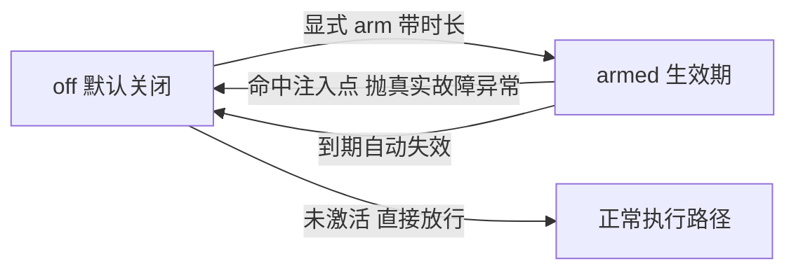

### Q2015 · 故障注入开关:运行时注入点设计

> 难度:★★★★ | 标签:故障注入, 混沌工程

**问**:想在生产环境演练下游超时,代码里要怎么埋故障,才能既练得到又不会忘关出事?

**答**:混沌工程的前提是故障可以安全注入:故障点常驻代码路径,但默认关闭,显式 arm 后才生效,且 arm 自带时长、到期自动失效——防止演练开关忘关变成真事故。实现 FaultSwitch:arm 设置失效时间戳,check 在调用点判断,未激活零开销直通,激活时抛出与真实故障同类型的异常(TimeoutError、ConnectionError),让上游的超时、重试、熔断真实演练一遍。实测下游超时被注入并被上游捕获,过期后调用恢复直通。三个约束:注入异常类型必须与真实故障一致,注入假的异常练不到处理逻辑;开关状态可观测(当前 arm 列表、注入次数);arm 操作全审计,谁能 arm、何时 arm 留痕。

```python
# file: code/05_数据分析与工程化/q2015_fault_switch.py
"""故障注入开关:默认关闭,显式 arm 才生效,带自动过期防遗忘"""

import time


class FaultSwitch:
    def __init__(self, name):
        self.name = name
        self.armed_until = 0.0
        self.triggered = 0

    def arm(self, seconds=60):
        self.armed_until = time.time() + seconds
        print(f"[fault] {self.name} 已激活 {seconds}s")

    def disarm(self):
        self.armed_until = 0.0

    @property
    def active(self):
        return time.time() < self.armed_until

    def check(self, error_factory):
        """调用点模板: 常驻代码路径,未 arm 时零开销直通"""
        if self.active:
            self.triggered += 1
            raise error_factory()
        return False


TIMEOUT_FAULT = FaultSwitch("downstream_timeout")


def call_downstream(latency):
    TIMEOUT_FAULT.check(lambda: TimeoutError(f"注入故障: 下游 {latency}ms 超时"))
    return f"ok({latency}ms)"


if __name__ == "__main__":
    print(call_downstream(20))
    TIMEOUT_FAULT.arm(seconds=1)
    try:
        call_downstream(35)
    except TimeoutError as e:
        print("注入命中并被上游捕获:", e)
    time.sleep(1.1)
    print("过期自动失效:", call_downstream(25))
    TIMEOUT_FAULT.disarm()
    print(f"注入次数 {TIMEOUT_FAULT.triggered}, 开关 active={TIMEOUT_FAULT.active}")
    print("要点:故障点常驻代码但默认关闭;arm 必须显式且自动过期,防止演练开关忘关变成真事故;注入的异常类型与真实故障一致,上游才练得到")
```



**追问**:
- 追问 1:为什么不只在测试环境注入?—— 生产故障形态(真实流量与数据量)测试环境造不出来,生产注入从最小半径开始。
- 追问 2:注入点放哪?—— 依赖边界(网络调用前后),别放业务判断内部,否则练的是业务逻辑不是容错。
