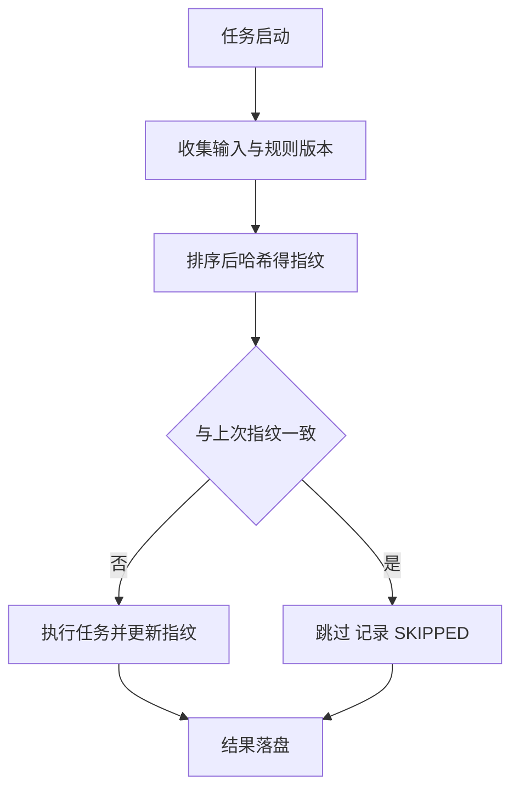

### Q2019 · 输入指纹跳过:内容寻址的增量执行

> 难度:★★★★ | 标签:增量计算, 指纹

**问**:调度器每天定时跑任务,但输入数据经常没变,怎么做到"没变就跳过、变了才重算",而且规则升级也能触发重算?

**答**:增量判断的依据不是"今天跑过了吗",而是"输入变了吗":对任务输入(数据参数加规则版本)排序后哈希成指纹,与上次一致就跳过,变了才重算并更新指纹。实测 agg_daily 第二次运行被跳过,规则版本从 v3 升到 v4 后自动重算——规则版本必须纳入指纹,只盯数据不变会漏算逻辑变更,这是增量系统最常见的 bug。同参数回填天然幂等:回填三天前的数据,指纹没变自动跳过。指纹状态与结果数据同生命周期清理,分区被删指纹也要删,否则会误跳过。输入超大时先对输入文件做内容哈希,任务层只哈希这些哈希。

```python
# file: code/05_数据分析与工程化/q2019_input_fingerprint.py
"""输入指纹跳过:对输入内容寻址,指纹没变就跳过,变了才重算"""

import hashlib
import json
import os
import tempfile

STATE = os.path.join(tempfile.mkdtemp(prefix="fp_demo_"), "fingerprints.json")


def fingerprint(inputs):
    """对输入键值对排序后哈希:内容决定指纹,顺序无关"""
    payload = json.dumps(sorted(inputs.items()), sort_keys=True)
    return hashlib.sha256(payload.encode()).hexdigest()[:16]


def load_fingerprints():
    if os.path.exists(STATE):
        with open(STATE) as f:
            return json.load(f)
    return {}


def run_task(task, inputs, log):
    fp = fingerprint(inputs)
    old = load_fingerprints().get(task)
    if old == fp:
        log.append(f"{task}: SKIPPED(指纹 {fp} 未变)")
        return
    log.append(f"{task}: RAN(指纹 {old} -> {fp})")   # 这里替换为真正计算
    state = load_fingerprints()
    state[task] = fp
    with open(STATE, "w") as f:
        json.dump(state, f)


if __name__ == "__main__":
    log = []
    daily = {"dt": "2026-11-04", "rows": 1200, "rule_ver": "v3"}
    run_task("agg_daily", daily, log)
    run_task("agg_daily", daily, log)          # 输入没变 -> 跳过
    daily["rule_ver"] = "v4"                   # 规则升级 -> 重算
    run_task("agg_daily", daily, log)
    for line in log:
        print(" ", line)
    print("要点:指纹对内容哈希而不是对时间,同参数重跑天然幂等;规则版本必须纳入指纹,只盯数据不变会漏算逻辑变更;指纹状态要与结果数据同生命周期清理")
```



**追问**:
- 追问 1:和 make 的思想什么关系?—— 完全一致:目标依赖输入,输入没变不重建;make 用 mtime,内容寻址更稳但成本更高。
- 追问 2:部分输入变化怎么处理?—— 指纹按输入组分开算,只重算受影响分支,这就是数据感知调度的原理。
