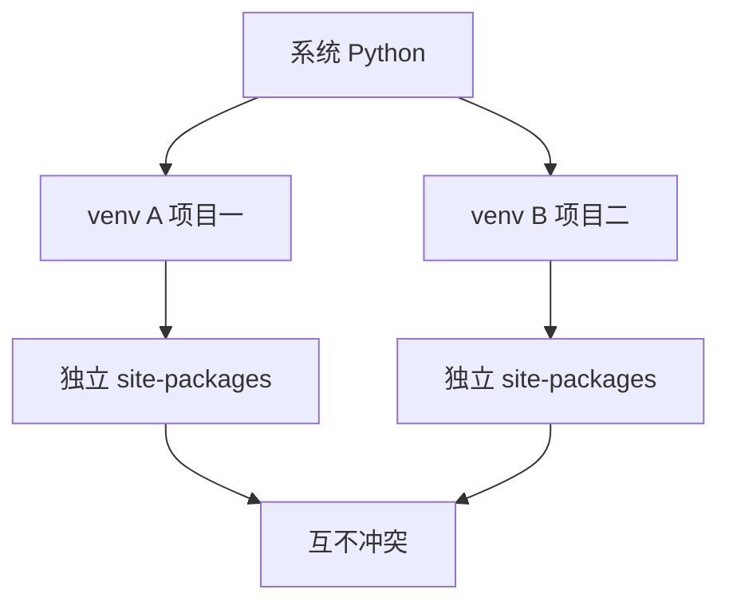

### Q206 · 虚拟环境的本质与常见坑

> 难度:★★☆ | 标签:venv, 环境

**问**:venv 到底是什么?为什么装了包还是 ModuleNotFoundError?

**答**:venv 本质是一个**带独立 site-packages 目录和 pyvenv.cfg 的目录**,激活脚本只是把它的 `bin` 放到 PATH 最前并把 `VIRTUAL_ENV` 写进环境——Python 解释器据此定位到该 venv 的 site-packages。**venv 不隔离解释器本身**(虚拟环境共享创建它时的那个 Python 版本),需要隔离解释器版本要用 pyenv/uv 管理多版本 Python 再分别建 venv。ModuleNotFoundError 的高频原因:IDE 用的解释器不是项目 venv、在 venv 外用系统 pip 装了包、notebook 内核指向了别的环境。系统 Python(PEP 668 后)禁止直接 pip install,必须建 venv 或用 --break-system-packages(不推荐)。

```python
# file: code/05_数据分析与工程化/q206_venv_demo.py
import sys


def env_info():
    # 运行时判断当前解释器是否在 venv 内
    in_venv = sys.prefix != sys.base_prefix
    return {
        "in_venv": in_venv,
        "prefix": sys.prefix,
    }


def test_venv_detection():
    info = env_info()
    assert isinstance(info["in_venv"], bool)
```

**追问**:
- IDE 运行测试和命令行结果不一致为什么?——两边解释器/venv 不同;统一用 `pip install -e .` 后的同一个环境,IDE 里显式选解释器。
- venv 怎么换 Python 版本?——venv 不支持,删除重建:先 pyenv/uv 装目标版本,再 `python -m venv` 或 `uv venv --python 3.12`。
- 为什么要 `.dockerignore` 掉 venv?——把本地 venv 拷进镜像轻则体积爆炸,重则 glibc/路径不兼容;镜像内依赖必须重装。


