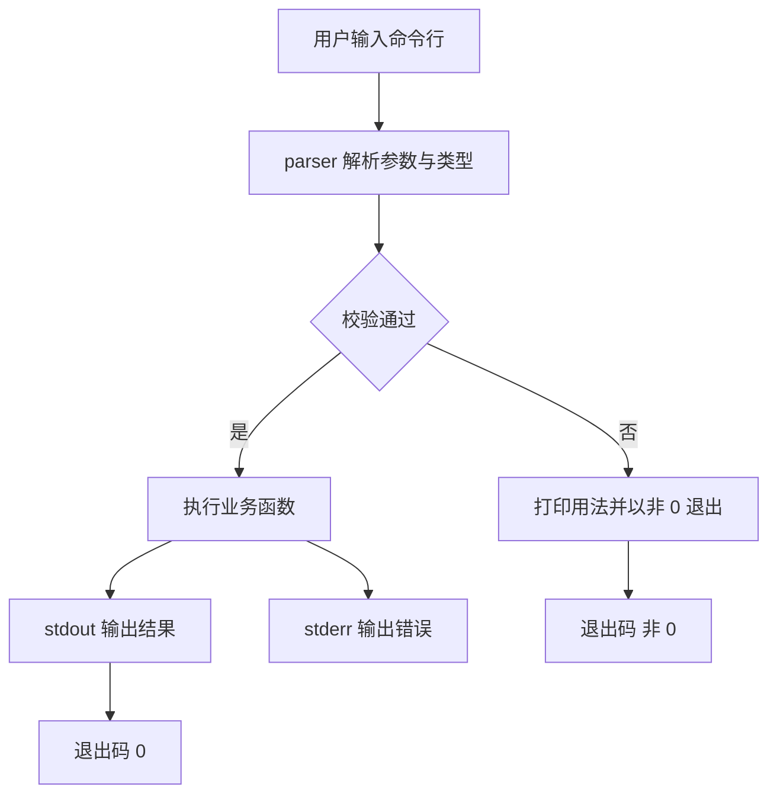

### Q210 · CLI 开发:argparse 与 typer

> 难度:★★☆ | 标签:argparse, typer, CLI

**问**:标准库 argparse 和第三方 typer 怎么选?

**答**:**argparse** 零依赖,适合脚本级工具;命令用 add_subparsers 组织,但代码随参数增多而膨胀。**typer** 基于 type hints:函数签名即 CLI 定义(参数名→选项、类型→解析校验、docstring→帮助文本),自动补全开箱即用,代码量大幅减少,底层是 click。现代项目首选 typer,除非必须零依赖。共同设计原则:退出码有意义(0 成功非 0 失败)、stdout 出数据 stderr 出错误、长任务输出进度、`--help` 自文档化。

```python
# file: code/05_数据分析与工程化/q210_cli_demo.py
import argparse


def build_parser() -> argparse.ArgumentParser:
    p = argparse.ArgumentParser(prog="sync", description="数据同步工具")
    p.add_argument("source")
    p.add_argument("--limit", type=int, default=100)
    p.add_argument("--dry-run", action="store_true")
    return p


def run_sync(source: str, limit: int, dry_run: bool) -> str:
    mode = "dry-run" if dry_run else "sync"
    return f"{mode} {source} limit={limit}"


def main(argv=None) -> int:
    args = build_parser().parse_args(argv)
    print(run_sync(args.source, args.limit, args.dry_run))
    return 0


if __name__ == "__main__":
    raise SystemExit(main(["db1", "--limit", "5", "--dry-run"]))
```

**追问**:
- 退出码为什么重要?——脚本被 CI/编排调用时靠退出码判断成败;异常退出但 exit 0 会让流水线误判成功继续跑。
- stdout/stderr 怎么分工?——数据走 stdout 供管道消费,日志与错误走 stderr;print 调试信息混进 stdout 会污染下游解析。
- typer 的参数和选项怎么区分?——位置参数是必填操作对象,`--option` 是可选配置;布尔开关用 flag,值选项给默认值。


