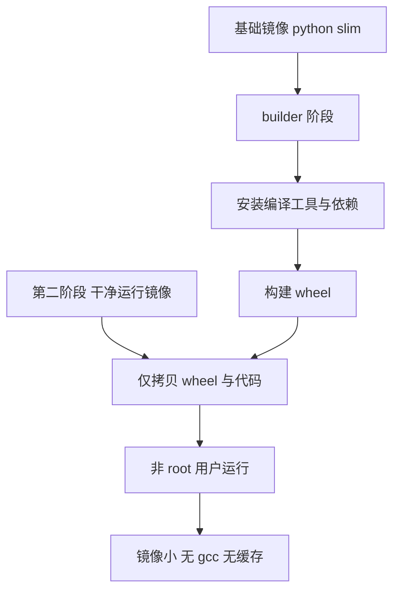

### Q213 · Dockerfile 最佳实践与多阶段构建

> 难度:★★★ | 标签:Docker, multi-stage

**问**:写一个生产级 Python Dockerfile,要注意什么?

**答**:核心实践:一,**多阶段构建**——builder 阶段装编译依赖与 dev 工具,运行阶段只拷贝 wheel/site-packages,不带 gcc;二,**层缓存友好**:先 COPY pyproject/lock 装依赖,再 COPY 代码,依赖不变时重建秒级;三,用 `python:3.12-slim` 而非 latest 或 alpine(Python 的 alpine 因 musl 编译包常翻车);四,**非 root 用户**运行;五,固定依赖来源(uv sync --frozen / pip install -r 带 hash);六,容器是单进程逻辑,前台运行,信号交给 PID 1 处理(可用 tini 或 exec 形式启动)。

```dockerfile
# Dockerfile:非 python 文件
FROM python:3.12-slim AS builder
WORKDIR /app
COPY pyproject.toml uv.lock ./
RUN pip install uv && uv sync --frozen --no-dev
COPY src ./src
RUN uv build --wheel

FROM python:3.12-slim
WORKDIR /app
COPY --from=builder /app/dist/*.whl /tmp/
RUN pip install --no-cache-dir /tmp/*.whl \
    && useradd -m runner
USER runner
CMD ["myproj"]
```

```python
# file: code/05_数据分析与工程化/q213_dockerfile_order.py
def layer_cache_plan(steps: list[tuple[str, str]]) -> list[str]:
    # 模拟构建:返回每步是否命中缓存
    # 依赖清单不变时,装依赖层可复用缓存
    cache = {"pyproject.toml+uv.lock": True, "src/": False}
    return [f"{action}:{cache.get(src, False)}" for action, src in steps]

def test_cache_hits():
    plan = layer_cache_plan([
        ("install deps", "pyproject.toml+uv.lock"),
        ("copy code", "src/"),
    ])
    assert plan == ["install deps:True", "copy code:False"]
```

**追问**:
- 为什么先 COPY 依赖清单再 COPY 代码?——层缓存:依赖文件不变时依赖层直接命中,代码改动重建只花秒级;顺序反了每次全量安装。
- 非 root 用户怎么配?——`RUN useradd -m app && USER app`;root 运行的容器被攻破即宿主机风险,这是安全基线。
- healthcheck 放 Dockerfile 还是编排层?——Kubernetes 自己管探针(忽略镜像 healthcheck);compose/单机部署才用 Dockerfile HEALTHCHECK。


