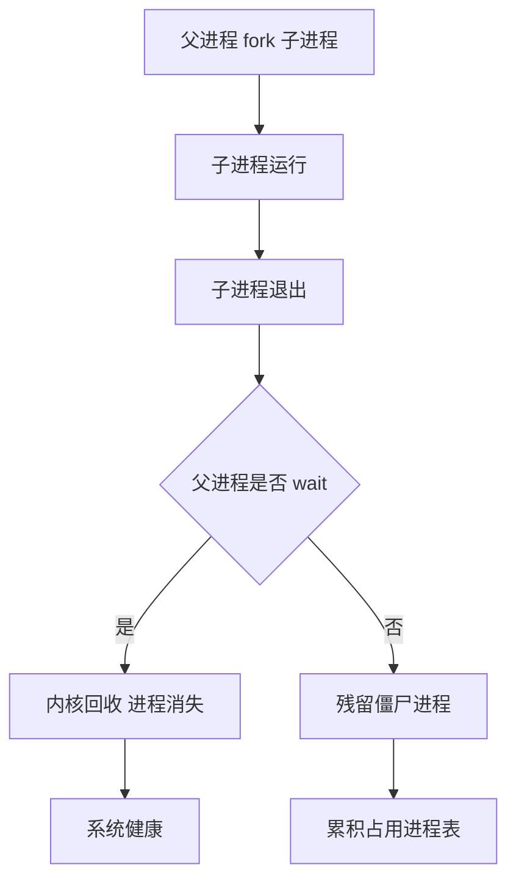

### Q218 · 进程泄漏与僵尸进程

> 难度:★★★ | 标签:子进程, 僵尸进程, 排查

**问**:父进程 fork 出的子进程退出了但没消失,是什么?怎么处理?

**答**:子进程退出后,内核保留其退出状态等待父进程 `wait()` 回收;父进程不 wait 也不退出,子进程就成了 **僵尸进程 zombie**(只占进程表项)。批量起子进程的 Python 服务(如用 subprocess/multiprocessing 的 worker)最容易积累。处理:用 `subprocess.Popen` 后**必须收尸**(wait/poll,或 `communicate`);multiprocessing 用 join 或让 daemon 子进程被 join;unix 下把 SIGCHLD 设为 SIG_IGN 可让内核自动回收;终极方案是进程管理器(supervisor/k8s)以正确 PID 1 语义运行并收割孤儿。与僵尸相对的是"活着的泄漏":进程数随请求线性涨,根因通常是 fork 后没回收句柄、连接池跨 fork 复用导致 fd 泄漏。

```python
# file: code/05_数据分析与工程化/q218_zombie.py
import subprocess
import sys


def run_and_reap(cmd: list[str]) -> int:
    # 正确收尸:communicate 会 wait,避免僵尸
    proc = subprocess.Popen(cmd, stdout=subprocess.DEVNULL)
    proc.wait()
    return proc.returncode


def test_no_zombie():
    code = run_and_reap([sys.executable, "-c", "print(1)"])
    assert code == 0
```

**追问**:
- 僵尸进程怎么现场确认?——`ps aux | grep Z` 或 ps 的 defunct 标记;父进程 PID 即元凶。
- subprocess 正确收尸姿势?——`p.wait(timeout)`/`p.poll()` 循环,或 `p.communicate()`;管道场景不 read 完会死锁,收尸前先 drain。
- SIGCHLD 自动收尸怎么写?——注册 signal.signal(SIGCHLD, 忽略/SIG_IGN) 让内核自动回收;仅 Unix,且要确认不影响其他信号逻辑。


