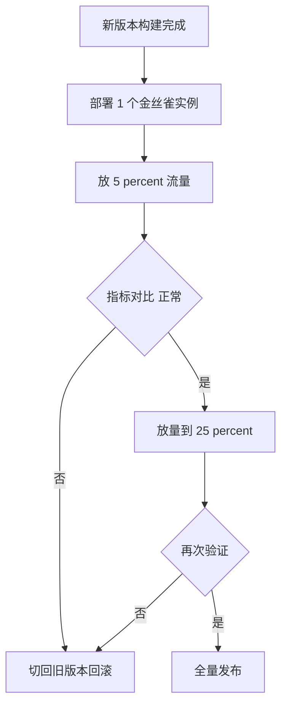

### Q221 · 灰度发布策略

> 难度:★★★ | 标签:灰度, 发布

**问**:新版本不敢直接全量,你会怎么做灰度?

**答**:常用策略按控制粒度:**金丝雀发布**——先放 1-5% 流量到新版本,观察错误率/延迟/业务指标无异常再逐步放量;**按规则灰度**——内部员工、白名单用户、特定地区先体验;**蓝绿部署**——新旧环境并存,切流可瞬时回退但资源翻倍;**A/B 与功能开关**(feature flag)——代码已部署但按开关决定行为,解耦发布与上线。工程要点:灰度期间要有**对照组指标对比**(新 vs 旧同口径),而不是看绝对值;流量分配要稳定(同一用户始终同版本);决策指标提前定义(什么情况叫停)。

```python
# file: code/05_数据分析与工程化/q221_canary.py
import hashlib


def assign_bucket(user_id: str, canary_percent: int = 5) -> str:
    # 稳定哈希分桶:同一用户永远落同一桶
    h = int(hashlib.md5(user_id.encode()).hexdigest(), 16) % 100
    return "canary" if h < canary_percent else "stable"


def test_bucket_stable():
    assert assign_bucket("u1", 5) == assign_bucket("u1", 5)

def test_bucket_ratio():
    users = [f"user-{i}" for i in range(1000)]
    canary = sum(1 for u in users if assign_bucket(u, 5) == "canary")
    assert 30 <= canary <= 70  # 约 5%
```

**追问**:
- 灰度期间看什么指标?——对照组对比:错误率、P99、核心业务转化;绝对值受流量波动影响,对比才有意义。
- 回滚怎么做到秒级?——旧版本不删、切流量/切镜像 tag;数据库变更必须向前兼容,否则代码回滚数据回不去。
- 按用户灰度怎么保证稳定?——哈希(user_id+salt)分桶,同一用户始终同版本;随机分配会让同一用户来回切换,体验与埋点都乱。


