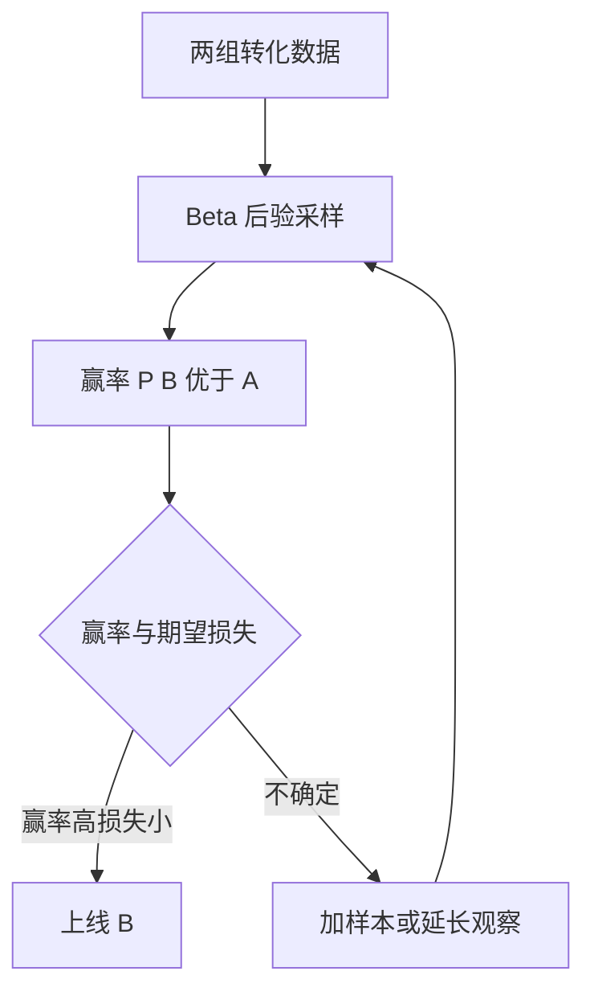

### Q2254 · 转化率的贝叶斯比较:后验采样与赢率

> 难度:★★★★ | 标签:贝叶斯, 实验

**问**:两个版本的转化率分别 4.5% 和 6.0%,业务问"B 更好吗",你怎么回答得比 p 值更可读?

**答**:用 Beta-二项后验回答:转化率服从 Beta(k+1, n-k+1) 后验,对两个版本各采样两万次,直接算 P(B 优于 A)。实测大样本组 B 的赢率约 99.9%,可以直接上;而小样本组 4/40 对 6/40 的同样差距,赢率只有七成多,后验区间宽得吓人,必须继续积累。输出三件东西比 p 值可读:每个版本转化率的后验 95% 区间、赢率、以及选错的期望损失——即选 B 平均会掉多少,实测大样本组期望损失约万分之四,业务可以直接拿它和切换成本比。这个框架天然处理小样本,也避免了"不显著就是没差异"的误读;先验要注明,默认用均匀先验或历史数据估的先验,两者结论差异要在报告里交代。

```python
# file: code/05_数据分析与工程化/q2254_bayes_winrate.py
"""转化率的贝叶斯比较: 后验采样与赢率"""

import random

random.seed(11)


def compare(k_a, n_a, k_b, n_b, size=20000):
    sa = [random.betavariate(k_a + 1, n_a - k_a + 1) for _ in range(size)]
    sb = [random.betavariate(k_b + 1, n_b - k_b + 1) for _ in range(size)]
    wins = sum(1 for x, y in zip(sa, sb) if y > x)
    loss = sum(max(x - y, 0) for x, y in zip(sa, sb)) / size
    sa.sort()
    lo, hi = sa[int(0.025 * size)], sa[int(0.975 * size)]
    return wins / size, loss, lo, hi


if __name__ == "__main__":
    print("== 大样本组 ==")
    p, loss, lo, hi = compare(45, 1000, 60, 1000)
    print(f"A 后验区间 [{lo:.2%}, {hi:.2%}], B 赢率 {p:.1%}, 选 B 的期望损失 {loss:.3%}")
    print("== 小样本组 ==")
    p2, loss2, lo2, hi2 = compare(4, 40, 6, 40)
    print(f"A 后验区间 [{lo2:.2%}, {hi2:.2%}], B 赢率 {p2:.1%}, 期望损失 {loss2:.3%}")
    print("要点: 赢率和期望损失比 p 值可读; 小样本赢率七成也敢说'倾向B但继续积累'; 先验来源必须写进报告")
```

**追问**:
- 追问 1:先验怎么定?—— 默认 Beta(1,1) 均匀先验;有历史转化数据时用经验贝叶斯估先验参数,并做先验敏感性对比。
- 追问 2:多次比较时这套框架怎么校正?—— 赢率阈值随比较次数上调,或对多个版本的赢率做归一化分配。


