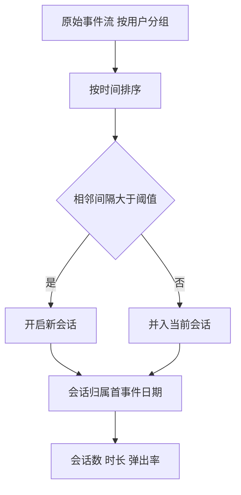

### Q2260 · 会话重建:30 分钟切分与跨午夜归属

> 难度:★★★☆ | 标签:会话, 埋点

**问**:日志里没有 session id,怎么从一串用户事件重建会话?跨零点的会话算哪一天的?

**答**:标准规则是 30 分钟不活跃切分:按用户分组、按时间排序,相邻事件间隔超过 30 分钟即开新会话。实测五组事件重建出四个会话,验证了三个边界:间隔 15 分钟的跨零点事件属于同一会话,会话归属首事件的日期,不能按自然日硬切;间隔 40 分钟的两次访问是两个会话;单事件会话计入弹出率。会话指标三件套要分开口径:会话数、会话时长(首尾事件差,只是活跃时长的下界)、弹出率(单事件会话占比)。工程上切分函数要做成纯函数便于回归测试,30 分钟阈值与归属规则写进口径字典;如果埋点端后来补了 session id,要抽样对比两种口径的差异再切换,防止指标断层。

```python
# file: code/05_数据分析与工程化/q2260_session_rebuild.py
"""会话重建: 30 分钟不活跃切分与跨午夜归属"""

from datetime import datetime, timedelta

EVENTS = [
    ("u1", "2026-03-01 23:40", "home"), ("u1", "2026-03-01 23:50", "list"),
    ("u1", "2026-03-02 00:05", "detail"),          # 跨午夜但间隔 15 分钟, 同一会话
    ("u1", "2026-03-02 09:00", "home"),            # 新会话
    ("u2", "2026-03-02 10:00", "home"),
    ("u2", "2026-03-02 10:40", "detail"),          # 间隔 40 分钟, 新会话
    ("u3", "2026-03-02 11:00", "home"),            # 单事件会话, 弹出
]
GAP = timedelta(minutes=30)
FMT = "%Y-%m-%d %H:%M"


def build_sessions(events):
    sessions, cur = [], []
    prev_t = prev_u = None
    for user, ts, page in events:
        t = datetime.strptime(ts, FMT)
        if prev_u != user or (cur and t - prev_t > GAP):
            if cur:
                sessions.append(cur)
            cur = []
        cur.append((user, t, page))
        prev_t, prev_u = t, user
    if cur:
        sessions.append(cur)
    return sessions


if __name__ == "__main__":
    sessions = build_sessions(EVENTS)
    bounce = sum(1 for s in sessions if len(s) == 1)
    print(f"共 {len(sessions)} 个会话, 弹出会话 {bounce} 个, 弹出率 {bounce / len(sessions):.0%}")
    for s in sessions:
        start = s[0][1]
        dur = (s[-1][1] - start).total_seconds() / 60
        print(f"{s[0][0]} 会话起始 {start:%m-%d %H:%M} 归属日 {start.date()} 页面数 {len(s)} 时长 {dur:.0f} 分钟")
    print("要点: 会话归属首事件日期, 跨零点不断开; 时长是活跃下界; 阈值与归属规则进口径字典")
```

**追问**:
- 追问 1:为什么是 30 分钟?—— 行业惯例源于早期网页分析,应结合自家访问间隔分布的断层校准,关键是全公司统一。
- 追问 2:后台播放这类长事件怎么处理?—— 心跳事件单独打标不计入切分,否则一个心跳间隔就把会话切碎。


