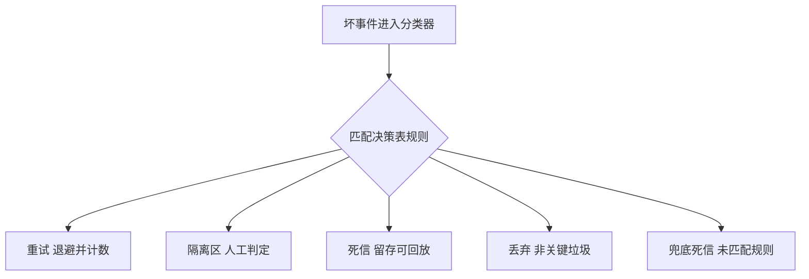

### Q2266 · 丢弃与死信的决策表:条件到动作的显式映射

> 难度:★★★★ | 标签:死信, 决策表

**问**:坏数据来了,重试、丢弃、隔离、进死信,靠什么决定?拍脑袋会怎样?

**答**:拍脑袋的结果通常是"要么无限重试堵死队列,要么随手丢弃丢掉真金白银"。正确做法是把处置规则做成显式决策表:条件是错误类型、重试次数、是否关键字段,动作是重试、隔离区、死信、丢弃,按顺序首条匹配生效。实测六条事件全部按表路由:关键字段格式坏进死信,非关键字段格式坏直接丢弃,超时未耗尽预算退避重试,耗尽转死信,业务校验失败进隔离区等人工判定,未匹配任何规则的走兜底进死信——宁可多存不可静默丢。决策表必须进配置随版本评审,每个动作带计数,丢弃量与死信量进日报;表里没有的异常形态会通过兜底路径暴露出来,推动规则补全,而不是被某个 if 分支悄悄吞掉。

```python
# file: code/05_数据分析与工程化/q2266_drop_dlq_decision_table.py
"""丢弃与死信的决策表: 条件到处置动作的显式映射"""

from collections import namedtuple

Event = namedtuple("Event", "id error retries critical")
# 决策表: 错误类型, 重试下限, 是否关键字段(None 不限) -> 动作, 理由
RULES = [
    ("格式错误", 0, True, "死信", "结构坏且关键字段缺失, 进死信等回放"),
    ("格式错误", 0, False, "丢弃", "非关键字段坏, 丢弃并计数, 别为垃圾占队列"),
    ("超时", 3, None, "死信", "重试预算耗尽, 转死信避免无限重试"),
    ("超时", 0, None, "重试", "预算未用完, 退避重试"),
    ("业务校验", 0, None, "隔离区", "格式对但业务不合理, 人工判定"),
]
FALLBACK = ("死信", "未匹配规则兜底, 宁可多存不可静默丢")


def route(event):
    for etype, min_retry, need_critical, action, why in RULES:
        if event.error != etype or event.retries < min_retry:
            continue
        if need_critical is not None and event.critical != need_critical:
            continue
        return action, why
    return FALLBACK


if __name__ == "__main__":
    stream = [
        Event("e1", "格式错误", 0, True),
        Event("e2", "格式错误", 0, False),
        Event("e3", "超时", 1, False),
        Event("e4", "超时", 5, False),
        Event("e5", "业务校验", 0, False),
        Event("e6", "未知异常", 0, False),
    ]
    for e in stream:
        action, why = route(e)
        print(f"{e.id} [{e.error} 重试{e.retries} 关键={e.critical}] -> {action}: {why}")
    print("要点: 决策表进配置走评审; 每个动作带计数; 兜底死信让未知形态暴露而不是被吞掉")
```

**追问**:
- 追问 1:隔离区和死信有什么区别?—— 隔离区是"疑似坏、待人工判",死信是"确认处理不了、留档可回放",两者的回放策略和保留期不同。
- 追问 2:丢弃为什么也要留痕?—— 只计数不留样就无法回答"丢了什么",留样本与丢弃原因才能在事后审计里还原。


