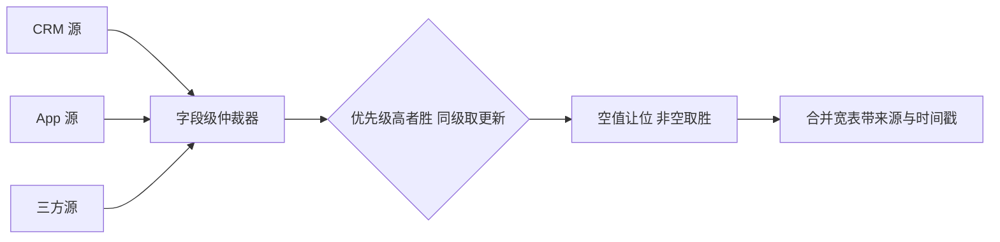

### Q2270 · 多源档案合并:字段级优先级与新鲜度仲裁

> 难度:★★★☆ | 标签:主数据, 数据合并

**问**:用户画像要从 CRM、App 埋点、三方数据三个来源合并,同一个字段大家给的值不一样,听谁的?

**答**:按字段配置取胜规则,而不是全局一刀切。每个字段维护来源优先级表,合并时过滤空值,优先级高者胜,同级取更新时间新的;每个字段必须留来源与时间戳,出错可回放。实测手机号 CRM 优先级最高取 CRM;城市 CRM 为空,跳过空值取 App 的杭州——空值永远让位是铁律,否则一个空值会覆盖真实数据;vip 等级 CRM 胜。再加兜底开关:某些字段可以设置最低可信来源门槛,实测城市只信 App 及以上来源时三方数据被排除。合并结果是一张带溯源列的宽表,审计问题"这个城市哪来的"一查便知。优先级表本身要走评审,因为"谁更可信"是业务判断;三方数据默认最低优先级,且有合规下线开关。

```python
# file: code/05_数据分析与工程化/q2270_field_arbitration.py
"""多源档案合并: 字段级优先级与新鲜度仲裁"""

PROFILES = {
    # 字段 -> [(来源, 值, 优先级, 更新批次)]
    "phone": [("crm", "138****", 3, "d5"), ("app", "139****", 2, "d1"), ("3rd", "137****", 1, "d2")],
    "city": [("crm", None, 3, "d5"), ("app", "杭州", 2, "d1"), ("3rd", "上海", 1, "d3")],
    "vip_level": [("crm", "gold", 3, "d5"), ("app", "silver", 2, "d1")],
}


def merge(records, min_priority=0):
    """优先级高者胜, 同级取更新者, 空值跳过"""
    valid = [r for r in records if r[1] is not None and r[2] >= min_priority]
    if not valid:
        return None, "无可用来源"
    valid.sort(key=lambda r: (-r[2], r[3]))
    return valid[0][1], f"来源 {valid[0][0]} 优先级 {valid[0][2]} 批次 {valid[0][3]}"


if __name__ == "__main__":
    for field, records in PROFILES.items():
        value, why = merge(records)
        print(f"{field:<10} -> {str(value):<10} ({why})")
    print("city 只信 App 及以上来源:", merge(PROFILES['city'], min_priority=2)[0])
    print("要点: 规则按字段配置; 每字段留来源与时间戳可回放; 空值永远让位, 三方来源默认最低级")
```

**追问**:
- 追问 1:两个高优先级来源打架怎么办?—— 配置互斥组强制二选一,或按业务规则(如实名信息只认 CRM)收敛,不引入随机性。
- 追问 2:溯源列要保留多久?—— 与画像数据同生命周期,至少覆盖一个回溯审计周期,溯源列本身也是个人数据要一并脱敏。


