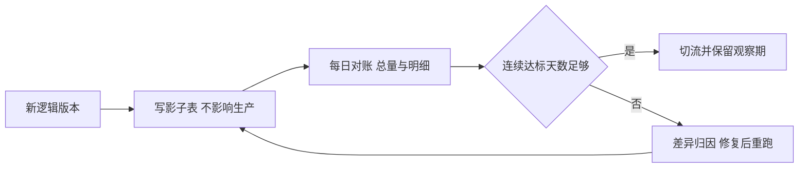

### Q2274 · 影子运行:新旧逻辑双跑对账再切流

> 难度:★★★★ | 标签:影子运行, 数据迁移

**问**:重写了一个核心聚合任务,怎么证明"新逻辑和旧逻辑等价"才敢切?

**答**:影子运行:新旧逻辑对同一份输入各算各的,新逻辑只写影子表,生产零影响;每天对账两组输出,指标覆盖总量(GMV、订单数)与明细行数,行数必须严格相等,总量给相对差容忍度。实测七日对账:D1 GMV 相对差 0.82% 超出 0.5% 容忍度,归因是新逻辑修了老逻辑的空值处理,属预期差异;从 D2 起连续六天达标,满足"连续 5 天达标"的切流门,判定通过切读端。切流不是终点:切后保留影子运行一个观察期防回退,对账差异要逐条归因(预期差异要写进差异台账,未预期差异必须查明才能切)。这套流程把"我觉得等价"变成可审计的证据链,迁移、口径重构、引擎替换都适用。

```python
# file: code/05_数据分析与工程化/q2274_shadow_run.py
"""影子运行: 新逻辑双跑对账, 达标才切流"""

DAYS = [
    # 天, GMV 相对差, 订单数相对差, 明细行数差
    ("D1", 0.0082, -0.0004, 0),
    ("D2", 0.0031, -0.0002, 0),
    ("D3", 0.0006, 0.0000, 0),
    ("D4", -0.0004, 0.0001, 0),
    ("D5", 0.0002, 0.0000, 0),
    ("D6", 0.0001, 0.0000, 0),
    ("D7", 0.0000, 0.0000, 0),
]
TOL = 0.005
NEED = 5   # 连续达标天数门槛建议


def gate(days, tol, need):
    streak = 0
    for day, gmv, order, rows in days:
        ok = abs(gmv) <= tol and abs(order) <= tol and rows == 0
        streak = streak + 1 if ok else 0
        print(f"{day}: GMV差 {gmv:+.2%} 订单差 {order:+.2%} -> "
              f"{'达标' if ok else '超标'} 连续达标 {streak}/{need}")
    return streak >= need


if __name__ == "__main__":
    promote = gate(DAYS, TOL, NEED)
    print(f"切流判定: {'通过, 可切换读端' if promote else '未通过, 继续双跑并归因超标天'}")
    print("要点: 新逻辑写影子表零影响; 对账含总量与行数; 差异先归因再切流, 预期差异进台账")
```

**追问**:
- 追问 1:双跑成本很高,能只跑抽样流量吗?—— 按用户或分区抽样可以降本,但总量对账就不严格了,等价性证明建议全量,日常监控才抽样。
- 追问 2:切流后老逻辑什么时候下线?—— 保留一个完整数据周期(含月末与节假日)的影子期,期间差异告警持续在线,期满才下线。


